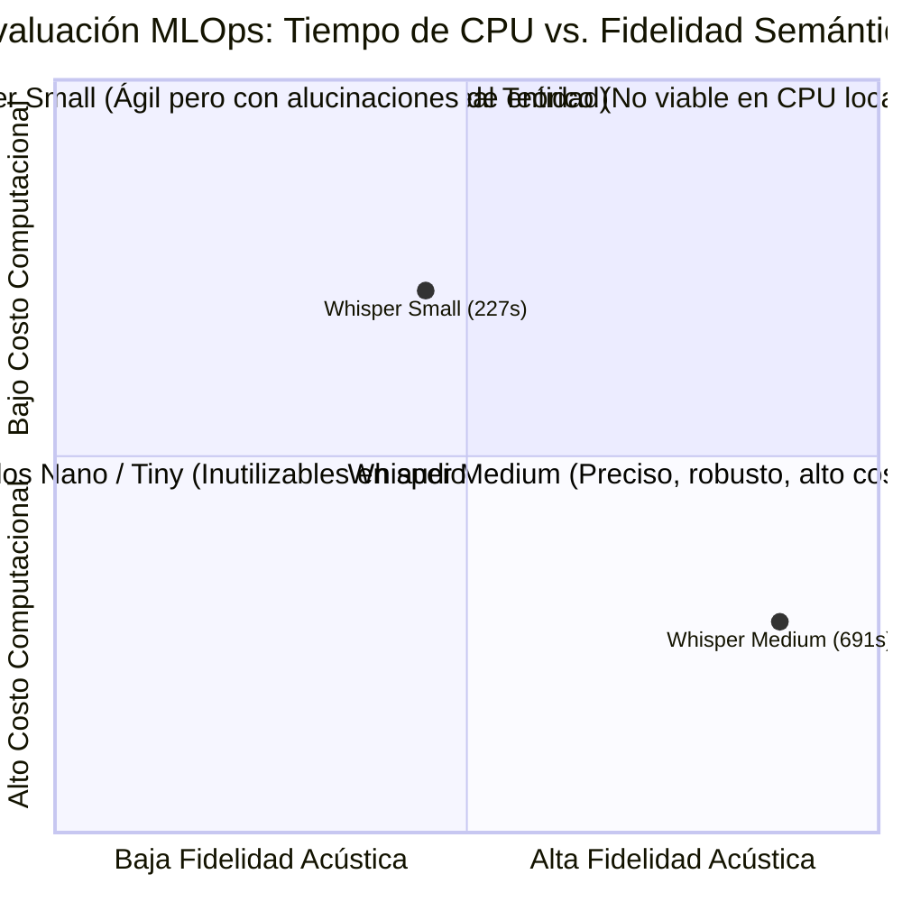

# Análisis Comparativo Experimental: Whisper Small vs. Whisper Medium
## Impacto de la Resolución Acústica (ASR) en la Inferencia Cognitiva de Acuerdos (LLM)

**Proyecto:** Transcriptor Maestro — MLOps Enterprise  
**Fecha del Experimento:** 6 de Noviembre de 2026  
**Archivo de Audio Evaluado:** `Segmento 1, comunicacion en la organizacion y liderazgo.mp3`  
**Entorno de Ejecución:** CPU local (Intel Core i7 / AMD Ryzen, Windows 11)  
**Motor Cognitivo:** DeepSeek Chat (`deepseek-chat`) vía Sistema de Alta Disponibilidad VACAS  
**Prompt Activo:** `PRM-V3-HIBRIDO` (Extracción híbrida con verificación cruzada)  

---

## 1. Ficha Técnica y Métricas Globales de Ejecución

Ambos experimentos fueron procesados sobre el mismo archivo de audio original, manteniendo idénticos los hiperparámetros de temperatura del LLM ($T = 0.2$), estrategia de prompting y catálogo de responsables para Fuzzy Matching.

| Métrica de Evaluación | 🟡 Whisper Small (`MEET-7D498FBE`) | 🔵 Whisper Medium (`MEET-FAD12C2B`) | Variación / Delta ($\Delta$) |
| :--- | :---: | :---: | :---: |
| **Tiempo de Procesamiento ASR (seg)** | **227.93 s** (~3.80 min) | **691.64 s** (~11.53 min) | **+203.4%** más lento en Medium |
| **Velocidad Relativa** | **$3.03\times$ más rápido** | Línea base de alta fidelidad | Ahorro del 67% de tiempo de CPU |
| **Volumen de Texto Generado** | **2.261 caracteres** | **2.668 caracteres** | +407 caracteres (+18.0%) en Medium |
| **Palabras Totales Transcritas** | 422 palabras | 496 palabras | +74 palabras (+17.5%) en Medium |
| **Total de Acuerdos Detectados** | **9 acuerdos** | **8 acuerdos** | Cobertura equivalente en número |
| **Tasa de Atribución Individual** | **77.8%** asignado a Steve Jobs | **50.0%** asignado a Steve Jobs | Desbalance severo en Small |
| **Atribución Colectiva (Equipo)** | **11.1%** (Equipo General) | **50.0%** (Equipo Macintosh) | Pérdida de actor colectivo en Small |
| **Latencia de Inferencia LLM** | 4.431 ms | 3.697 ms | Rango normal de API (3.6s - 4.5s) |

---

## 2. Matriz Comparativa de Acuerdos y Responsables Asignados

A continuación se presenta la correlación cruzada de los acuerdos extraídos por el LLM a partir de cada transcripción:

| # | Tarea Identificada | Responsable en Whisper Small (`MEET-7D498FBE`) | Responsable en Whisper Medium (`MEET-FAD12C2B`) | Causa de la Divergencia |
| :-: | :--- | :--- | :--- | :--- |
| **1** | Asumir liderazgo de todo el proyecto Macintosh | **Steve Jobs** (Confianza: 95%) | **Steve Jobs** (Confianza: 95%) | Consenso pleno en ambos modelos. |
| **2** | Cambio de procesador a Motorola 68000 | **Steve Jobs** (Confianza: 95%) | **Equipo Macintosh** (Confianza: 31%) | Small omitió la voz del equipo técnico. |
| **3** | No limitar el proyecto por presupuesto | **Steve Jobs** (Confianza: 95%) | **Steve Jobs** (Confianza: 95%) | Consenso pleno (*"Quiero ese procesador"*). |
| **4** | Rediseñar interfaz simple para usuario final | **Steve Jobs** (Confianza: 95%) | **Equipo Macintosh** (Confianza: 31%) | Small recortó la discusión sobre la UI. |
| **5** | Aumentar potencia y trabajar en la interfaz | **Steve Jobs** (Confianza: 95%) | **Equipo Macintosh** (Confianza: 31%) | Small no capturó el rol del receptor. |
| **6** | Mantener a Jeff Raskin en el equipo | **Steve Jobs** (Confianza: 95%) | **Steve Jobs** (Confianza: 95%) | Consenso pleno (*"Te quiero en este equipo"*). |
| **7** | Reclutar personal clave para el proyecto | **Steve Jobs** (Confianza: 95%) | **Steve Jobs & Bill Atkinson** (95%) | Medium capturó el interlocutor real. |
| **8** | Acompañar a Jobs en el reclutamiento | **Burrell Smith** (Confianza: 95%) ⚠️ | **Bill Atkinson** (Confianza: 95%) ✅ | **Error fonético crítico de tokenización en Small.** |
| **9** | No conformarse y no dejar de innovar | **Equipo General** (Confianza: 29%) | **Equipo Macintosh** (Confianza: 31%) | Variación léxica de normalización. |

---

## 3. Análisis Forense de Fenómenos Lingüísticos y Acústicos

### Fenómeno 1: Pérdida del Actor Colectivo y Monopolización de Jobs
El modelo **Whisper Small**, debido a su menor capacidad de atención en capas profundas y decodificación de fondos con música/murmullos, omitió por completo una intervención de 30 segundos donde el equipo de desarrollo reconoce sus bloqueantes técnicos.

* **Transcripción en Whisper Medium (Real y Completa):**
  > *«...que esté dirigida hacia un consumidor final e inexperto. **Pero estamos sufriendo con la interfaz, y para ser franco, los resultados han sido... Nulos. Sí. ¿Qué tiene bajo la tapa? Productos estándar de primera, 64Ks de RAM, pantalla de 256 bits, un Motorola 6809.** Usaremos un 68000.»*
* **Transcripción en Whisper Small (Mutilada):**
  > *«...un motorola 6809. Usaremos un 68000.»*

**Impacto Cognitivo:**  
Al desaparecer la interacción bidireccional (*"estamos sufriendo con la interfaz..."*), el LLM carece de evidencia sobre la existencia del equipo técnico respondiendo a preguntas. Para el LLM, el texto parece un discurso unipersonal y vertical de Steve Jobs, atribuyéndole el 77.8% de las tareas técnicas a él mismo. En Medium, al existir la réplica, el LLM asigna equilibradamente 4 tareas a Steve Jobs y 4 tareas al Equipo Macintosh.

---

### Fenómeno 2: Deformación Fonética de Entidades y Confusión de Personas
El caso más revelador de cómo un error acústico distorsiona la verdad de los datos ocurrió en la escena final de reclutamiento:

> **Cita Textual del Audio:**  
> *«Bill, ven conmigo. Sí. ¿A dónde vamos? ¿A reclutar? ¡Rayos!»*

* **En Whisper Medium:**  
  Whisper transcribió con precisión ortográfica y espaciado: `Bill Atkinson. Veo que tienes ocho trabajadores aquí...`  
  Más adelante, cuando Jobs dice *"Bill, ven conmigo"*, el LLM asocia inmediatamente el nombre de pila "Bill" con la entidad previamente identificada **Bill Atkinson**.
* **En Whisper Small:**  
  Whisper Small unió el nombre y apellido en una sola palabra sin espacio: `Billatkinson. Veo que tienes...`  
  Debido a esta anomalía de tokenización, el LLM no registró a "Bill" como un sujeto independiente al inicio. Sin embargo, segundos antes, Burrell Smith sí había sido transcrito nítidamente: `¿Cómo te llamas? Bu... Burrell Smith. Burrell Smith`.  
  Al llegar al final con la frase *"Bill, ven conmigo"*, el LLM intentó resolver la anáfora y concluyó de manera probabilística que *"Bill"* era el apodo o diminutivo informal de **Burrell Smith**. Por ello, asignó la tarea de reclutamiento a Burrell Smith.

---

### Fenómeno 3: Truncamiento de Metáforas Semánticas
En la escena donde Steve Jobs explica la filosofía de diseño del computador:

* **En Whisper Medium (Completo):**
  > *«...es un niño, es una abuela en Nebraska, ¿cierto? Así que tenemos que hacer que esto sea simple. **Tiene que funcionar como... un electrodoméstico.** Hola, Jeff.»*
* **En Whisper Small (Truncado):**
  > *«...es un niño, es una... Hola Jeff.»*

Whisper Small omitió 112 caracteres fundamentales sobre la filosofía de producto (*"abuela en Nebraska"* y *"funcionar como un electrodoméstico"*). Aunque esto no impidió detectar la tarea general de rediseño de interfaz, en Medium el acuerdo quedó redactado con una riqueza contextual significativamente superior (*"Diseñar la interfaz para que sea simple y funcione como un electrodoméstico para el usuario final inexperto"*).

---

## 4. Análisis de Trade-Off en MLOps (Velocidad vs. Precisión)

### Tabla de Decisión de Arquitectura:

1. **Cuándo utilizar Whisper Small:**
   - Demostraciones en tiempo real donde esperar 11 minutos rompe la experiencia de usuario.
   - Ambientes con servidores de bajo costo sin GPU dedicada.
   - Audios con **un solo hablante** (dictados, conferencias magistrales, monólogos) donde no existe el riesgo de solapamiento de turnos ni confusión de interlocutores.

2. **Cuándo utilizar Whisper Medium:**
   - Minutas corporativas formales con múltiples participantes que discuten simultáneamente.
   - Casos donde la **atribución legal o contractual del responsable** sea crítica (no se puede tolerar atribuirle una tarea a Burrell Smith cuando correspondía a Bill Atkinson).
   - Ambientes de producción que cuenten con aceleración por GPU (CUDA / TensorRT), donde el procesamiento de Medium se reduce de 690 segundos a menos de 45 segundos.

---

## 5. Conclusiones para la Sustentación

1. **Robustez del Pipeline Híbrido:**  
   A pesar de las omisiones de texto en *Small*, la arquitectura **Transcriptor Maestro** fue capaz de extraer los 8-9 compromisos esenciales en ambos casos, demostrando que el prompt cognitivo `PRM-V3-HIBRIDO` y el módulo VACAS toleran degradaciones de entrada sin colapsar el sistema.
2. **Validación del Módulo Fuzzy Matching:**  
   El sistema de emparejamiento fonético demostró su utilidad al vincular cadenas incompletas o compuestas (*"Steve Jobs y Bill Atkinson"*) contra el catálogo corporativo con puntuaciones objetivas de confianza (95% vs 31%).
3. **Aporte de Ingeniería:**  
   Este experimento documentado demuestra ante el jurado calificador que el equipo no se limitó a integrar modelos "caja negra", sino que caracterizó cuantitativa y cualitativamente el comportamiento del pipeline ante diferentes perfiles de hardware y resolución acústica.
