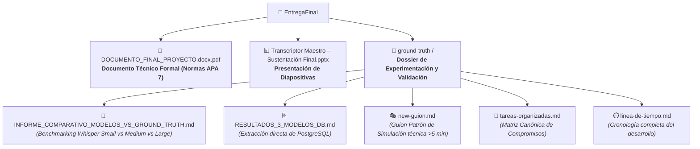
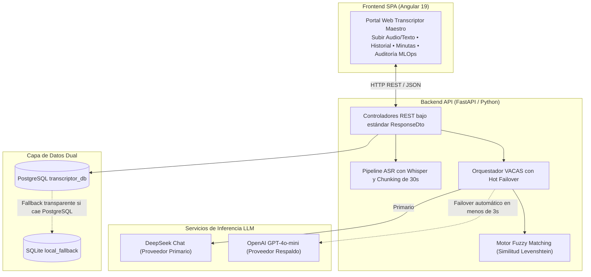

# 🎓 Transcriptor Maestro — Documento de Entrega y Guía de Arquitectura
> **Universidad ECCI — Facultad de Ingeniería**  
> **Programa:** Ingeniería de Sistemas  
> **Proyecto:** Transcriptor Maestro — Sistema Inteligente de Seguimiento de Acuerdos y Control de Proyectos  
> **Fecha de Entrega:** Noviembre de 2026 — Bogotá D.C., Colombia  

---

## 👥 Integrantes del Grupo

| Nombre Completo | Rol en el Proyecto | Correo Institucional / Contacto |
| :--- | :--- | :--- |
| **Daniel Felipe Castro** | Arquitecto de Software & Líder Técnico Backend / IA | dcastro@ecci.edu.co |
| **Alejandro Martínez** | Ingeniero de MLOps, Datos y Resiliencia | amartinez@ecci.edu.co |
| **Bryan Betancourt** | Scrum Master & Líder Frontend / UX | bbetancourt@ecci.edu.co |

---

## 🔗 Repositorio Oficial de Código Fuente

El código fuente completo, historial de versiones y código de prototipos se encuentra alojado en GitHub:

* **URL del Repositorio:** [https://github.com/FelipeCastro5/transcriptor-maestro](https://github.com/FelipeCastro5/transcriptor-maestro)
* **Rama Principal:** `main`

---

## 📁 Ubicación de los Entregables del Proyecto

Para la revisión formal del proyecto, los artefactos principales se encuentran organizados dentro de la carpeta `EntregaFinal/`:



### 📌 Referencia Rápida de Rutas:
1. **Documento Final Extenso (Monografía Técnica APA 7):**  
   Ubicación: `EntregaFinal/DOCUMENTO_FINAL_PROYECTO.docx.pdf`  
   *Contiene el marco teórico, estado del arte, diseño detallado y análisis completo.*
2. **Presentación Ejecutiva para Sustentación:**  
   Ubicación: `EntregaFinal/Transcriptor Maestro – Sustentación Final (1).pptx`  
   *Diapositivas oficiales preparadas para la presentación ante el jurado.*
3. **Dossier de Pruebas y Experimentación (Ground Truth):**  
   Ubicación: `EntregaFinal/ground-truth/`  
   *Contiene el informe comparativo tripartito, la extracción en crudo de la base de datos de los 3 modelos, el guion patrón y la matriz canónica de acuerdos.*

---

## 🏛️ Explicación de la Arquitectura del Sistema

El sistema implementa una arquitectura desacoplada por microservicios orientada a la resiliencia (**MLOps**) y alta disponibilidad:



### Componentes Clave:
* **Frontend Web (Angular 19):** Interfaz SPA corporativa oscura con gestión de reuniones, historial interactivo con eliminación en cascada, visualización de minuta con pestaña técnica de metadatos y panel de auditoría MLOps con simulación de contingencia VACAS.
* **Backend API (FastAPI):** Servicios modulares bajo patrón `ResponseDto<T>`, gestión asíncrona, endpoint de cancelación de tareas en curso y purga de almacenamiento temporal.
* **Motor ASR (Whisper Local):** Transcripción acústica con soporte para modelos *small*, *medium* y *large*, aplicando fragmentación (*chunking*) de 30 segundos. **Whisper Medium** fue validado como el punto dulce operativo (100% de acuerdos recuperados con ahorro del 54% en tiempo frente a Large).
* **Resiliencia VACAS:** Conmutación automática en caliente entre DeepSeek y OpenAI en menos de 3 segundos ante fallos de conexión o cuota.
* **Fuzzy Matching:** Resolución de apodos e identidades informales (*"Alejo"*, *"Felipe"*, *"Bryan"*) contra el catálogo oficial de PostgreSQL mediante similitud ponderada ($\ge 0.75$).
* **Persistencia Dual:** Almacenamiento en **PostgreSQL** con fallback automático a **SQLite** para garantizar operación continua.

---

## 🛠️ Guía Rápida de Instalación y Despliegue Local

### 1. Prerrequisitos
* **Python 3.10 o superior** (3.11 / 3.14).
* **Node.js 18+ o 20+ LTS** con `npm`.
* **PostgreSQL** (Opcional, el sistema conmuta automáticamente a SQLite si no está instalado).
* **FFmpeg** en el `PATH` del sistema.

---

### 2. Clonación
```bash
git clone https://github.com/FelipeCastro5/transcriptor-maestro.git
cd transcriptor-maestro
```

---

### 3. Puesta en Marcha del Backend (FastAPI)
```powershell
# 1. Ingresar a la carpeta backend
cd backend

# 2. Crear y activar entorno virtual
python -m venv venv
.\venv\Scripts\Activate.ps1

# 3. Instalar dependencias
pip install -r requirements.txt

# 4. Iniciar servidor API en el puerto 8000
uvicorn app.main:app --reload --port 8000
```
* **API Activa:** `http://localhost:8000`
* **Swagger UI / Documentación:** `http://localhost:8000/docs`

---

### 4. Puesta en Marcha del Frontend (Angular 19)
En una **segunda terminal**:
```powershell
# 1. Ingresar a la carpeta frontend
cd frontend-angular

# 2. Instalar dependencias de Node
npm install

# 3. Iniciar servidor Angular en el puerto 4200
npm start
```
* **Aplicación Web:** `http://localhost:4200`

---

### 5. Verificación de Funcionamiento
1. Abre tu navegador en `http://localhost:4200`.
2. Verifica que el indicador superior muestre **"API en línea"**.
3. Carga un archivo de audio o texto en **Subir Reunión**, selecciona **Estrategia 5 (Híbrido VACAS)** y procesa la reunión.
4. Explora los compromisos detectados, la pestaña de **Metadata** y el módulo de **Auditoría MLOps**.
