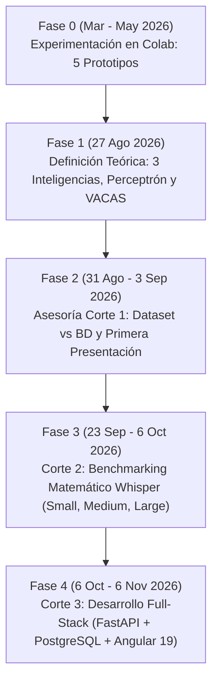

# 📘 DOCUMENTO MAESTRO: CRONOLOGÍA, ARQUITECTURA, MATEMÁTICAS Y CONSOLIDADO GENERAL
## Proyecto: Sistema Inteligente de Seguimiento de Acuerdos y Control de Proyectos ("Transcriptor Maestro")

* **Universidad:** Universidad ECCI — Facultad de Ingeniería — Ingeniería de Sistemas
* **Asignatura:** Electiva II (Sistemas Inteligentes / MLOps)
* **Docente:** Ing. Andrés Felipe Duque Montenegro
* **Autores:**
  * Bryan Alexander Betancourt Rojas
  * Daniel Felipe Castro Lizarazo
  * Alejandro Martínez López
* **Fecha de consolidación:** Noviembre de 2026

---

## 🧭 1. MAPA DE NAVEGACIÓN DEL PROYECTO (¿Dónde está cada cosa?)

A lo largo del semestre se generaron múltiples documentos, análisis, prototipos y pruebas repartidos en la raíz del proyecto. Esta tabla clasifica **qué contiene cada archivo/carpeta** y **para qué sirve en la Entrega Final**:

| Ruta / Archivo | Fecha Clave | Contenido Principal | Utilidad para la Entrega Final |
| :--- | :---: | :--- | :--- |
| [`jupiter/`](../jupiter) | Mar – May 2026 | Los 5 Notebooks originales de Google Colab (`intento 1` a `intento 5`). | Evidencia de la fase exploratoria de modelos ASR, diarización y LLMs. |
| [`pys/`](../pys) | 27/08/2026 | Scripts `.py` exportados de Colab con las 5 estrategias base. | Código fuente de referencia que dio origen al `AIHandler` del backend. |
| [`contexto.md`](../contexto.md) | 27/08/2026 | Resumen inicial del problema, las 3 fases (ASR, LLM, Exportación). | Introducción rápida y planteamiento ejecutivo. |
| [`tarea.md`](../tarea.md) | 27/08/2026 | Estructura exigida para el documento y presentación del Primer Corte (13 puntos). | Lista de chequeo (*checklist*) de secciones académicas obligatorias. |
| [`versiones_prototipos.md`](../versiones_prototipos.md) | 27/08/2026 | Análisis técnico detallado y **tabla comparativa multicriterio** de los 5 prototipos. | Justificación del diseño del **Handler Dinámico** y elección del Intento 5. |
| [`arquitectura.md`](../arquitectura.md) | 27/08/2026 – 31/08/2026 | Diseño de la Arquitectura Híbrida Distribuida (Frontend, FastAPI, Redis/Celery, Workers, PostgreSQL). | Sustento arquitectónico del sistema productivo construido en el Tercer Corte. |
| [`SISTEMA INTELIGENTE DE SEGUIMIENTO DE ACUERDOS Y CONTROL DE PROYECTOS (6).md`](../SISTEMA%20INTELIGENTE%20DE%20SEGUIMIENTO%20DE%20ACUERDOS%20Y%20CONTROL%20DE%20PROYECTOS%20(6).md) | 27/08/2026 – 31/08/2026 | **Biblia Teórica de Automatización:** Las 3 Inteligencias, Diccionario de 11 Variables, Estados Binarios (0/1), Réplicas (VACAS), Perceptrón (Megatron), Jerarquía de Errores (0–4), Tolerancia/Desviación, Curvas de Control y 3 opciones de despliegue (On-Premise, Nube Pura, Híbrido Real). | Núcleo teórico de la asignatura (conceptos de las Clases 3, 10, 13, 14 y 16). |
| [`solucion-contenido-completo.md`](../solucion-contenido-completo.md) | 27/08/2026 – 01/09/2026 | Documento consolidado con las 13 secciones de ingeniería de producto, historias de usuario (HU01–HU05), SLOs, DevOps, MLOps, Sprints y referencias IEEE/arXiv. | Base formal del informe escrito final. |
| [`observaciones/`](../observaciones) | 31/08/2026 | Transcripción cruda de la asesoría con el docente (`obs-crudo.txt`), resumen de correcciones (`obs1.md`) y planes de choque (`analisis1.md`, `analisis2.md`). | Explica por qué se separó el concepto de *Dataset de IA* del *Modelo Relacional PostgreSQL*. |
| [`dataset.md`](../dataset.md) y [`dataset-informal.md`](../dataset-informal.md) | 31/08/2026 | Fichas técnicas del Dataset: versión de reuniones simuladas (15 audios de 5–10 min) y versión *Stress Test* (conferencias/sustentaciones reales de 1–2 h). | Documentación formal del conjunto de datos, metadatos CSV y *Ground Truth*. |
| [`estructura-presentacion.md`](../estructura-presentacion.md) y [`presentacion/`](../presentacion) | 01/09/2026 – 03/09/2026 | Estructura de 11 diapositivas, guion palabra por palabra (`guion.md`) y documento formal (`Documento-Solucion-Seguimiento-Acuerdos.docx.md`). | Material base para las diapositivas y defensa oral del equipo. |
| [`otras-actividades/`](../otras-actividades) y [`clases/clases.md`](../clases/clases.md) | 10/09/2026 | Apuntes de clase y caso práctico de regresión (Consumo energético UCI ID 242). | Referencia metodológica de EDA, preprocesamiento y rigor estadístico exigido por el docente. |
| [`metricas/`](../metricas) | 23/09/2026 – 06/10/2026 | **Evaluación Matemática del Segundo Corte:** Teoría de las 10 métricas (`metricas.md`), audio real de prueba (`original.mp3`), Ground Truth (`original.txt`), 9 transcripciones de Whisper (`Small`, `Medium`, `Large`), tiempos (`rendimiento-modelos.txt`) e [`INFORME CORPORATIVO.md`](../metricas/INFORME%20CORPORATIVO.md) con las recomendaciones del tutor para el Tercer Corte. | Evidencia experimental cuantitativa (tablas, fórmulas, análisis de alucinaciones y trade-offs). |
| [`prototipos/`](../prototipos) | 06/10/2026 – 06/11/2026 | **Aplicación Real Full-Stack:** Backend FastAPI (`prototipos/backend`), Base de Datos PostgreSQL (`prototipos/db`) y Frontend Angular 19 (`prototipos/frontend-angular`). | Entregable funcional desplegado localmente para la sustentación final. |

---

## ⏳ 2. CRONOLOGÍA EVOLUTIVA DEL PROYECTO (Línea de Tiempo Real)

El proyecto evolucionó a través de **5 grandes etapas cronológicas** que conectan la investigación inicial con el sistema en producción:

### 🔹 Etapa 0: Semilla y Prototipado en Google Colab (Marzo – Mayo 2026)
* **28 de marzo de 2026:** Se crean en Google Colab los primeros cuadernos experimentales en [`jupiter/`](../jupiter):
  * `intento 1 FUNCIONA DIARIZACION`: Prueba de transcripción con `openai-whisper` local, diarización acústica por energía RMS (`torchaudio`) y extracción gramatical sin LLM usando `spaCy` (`es_core_news_sm`) y expresiones regulares.
  * `intento 3 FUNCIONA`: Primera integración exitosa entre `openai-whisper` (modelo `small`) y la API comercial de **DeepSeek** (`deepseek-chat`) devolviendo JSON.
  * `intento 4 FUNCIONA`: Evolución del prompt hacia un **"Prompt Mejorado para conversaciones informales"** capaz de capturar compromisos tácitos (*"yo me encargo"*, *"lo reviso mañana"*) y exportar cuadros de mando en Markdown.
* **3 de mayo de 2026:** Se desarrollan dos nuevos enfoques para resolver problemas de memoria RAM (*Out Of Memory* - OOM) en audios largos:
  * `intento 2 FUNCION SIN DEEPSEEK`: Implementa el pipeline de `transformers` de Hugging Face con **fragmentación (*chunking*) de 30 segundos** y solapamiento (*stride*) de 5 segundos, conectándose al LLM Open Source `moonshotai/Kimi-K2-Instruct-0905`.
  * `intento 5 FUNCIONA WHISPER DEEPSEEK`: **El prototipo híbrido maduro.** Combina el *chunking* de 30s de Hugging Face con una **doble llamada a DeepSeek** (una para extraer el JSON validado con `Pydantic` y otra para redactar el Resumen Ejecutivo).

### 🔹 Etapa 1: Formalización de Sistemas Inteligentes y Automatización (27 de Agosto de 2026)
* Se exportan los 5 cuadernos a scripts limpios en [`pys/`](../pys) y se redacta el cuerpo teórico en [`SISTEMA INTELIGENTE DE SEGUIMIENTO DE ACUERDOS Y CONTROL DE PROYECTOS (6).md`](../SISTEMA%20INTELIGENTE%20DE%20SEGUIMIENTO%20DE%20ACUERDOS%20Y%20CONTROL%20DE%20PROYECTOS%20(6).md), [`arquitectura.md`](../arquitectura.md) y [`versiones_prototipos.md`](../versiones_prototipos.md).
* Se estructura el sistema bajo **3 Inteligencias** (Lingüística, Lógico-Matemática e Interpersonal).
* Se incorporan los principios de ingeniería de control y automatización vistos en clase:
  * **Diccionario de 11 variables** estandarizadas.
  * **Estados binarios absolutos (0 = Éxito, 1 = Fallo)** por etapa.
  * **Sistema VACAS (Variables de Respaldo Gemelas)** para conmutación entre LLMs en $< 1.5\text{ s}$.
  * **El Perceptrón (Megatron)** como auditor asíncrono en paralelo.
  * **Jerarquía de Errores (Niveles 0 a 4)**, **Tolerancias de Desviación** y **Curvas de Control**.

### 🔹 Etapa 2: Retroalimentación del Primer Corte y Ficha del Dataset (31 de Agosto – 3 de Septiembre de 2026)
* **31 de agosto de 2026:** En la asesoría de la Clase 6 ([`observaciones/obs-crudo.txt`](../observaciones/obs-crudo.txt) y [`obs1.md`](../observaciones/obs1.md)), el docente aprueba el enfoque de evaluar los 5 prototipos y la estrategia de MLOps (Perceptrón/VACAS), pero realiza dos correcciones clave:
  1. **Diferenciar Dataset vs. Base de Datos Relacional:** Para entrenar/evaluar la IA, el entregable es el **Dataset de audios crudos + metadatos + Ground Truth**, no el diagrama entidad-relación de PostgreSQL.
  2. **Rechazo de audios limpios de películas:** Exige usar grabaciones con ruido ambiental real.
* En respuesta, el mismo **31 de agosto** se crean [`dataset.md`](../dataset.md) (15 reuniones simuladas de 5–10 min con ruido real) y [`dataset-informal.md`](../dataset-informal.md) (*Stress Test* con grabaciones reales in-situ de sustentaciones y conferencias de 1 a 2 horas).
* **1 al 3 de septiembre de 2026:** Se consolidan [`solucion-contenido-completo.md`](../solucion-contenido-completo.md), [`estructura-presentacion.md`](../estructura-presentacion.md) y los archivos de [`presentacion/`](../presentacion) para la defensa del Primer Corte.

### 🔹 Etapa 3: Evaluación Matemática y Benchmarking de Whisper — Segundo Corte (23 de Septiembre – 6 de Octubre de 2026)
* **23 de septiembre de 2026:** Se prepara el audio real del caso de estudio: una reunión gerencial de la empresa **Pesquera Diamante** (`original.mp3`, ~8 minutos, 6 interlocutores, variante de español peruano con micro-cortes de conexión y jerga técnica).
* **28 de septiembre de 2026:** Se ejecutan **9 corridas experimentales** en Google Colab (3 intentos con `whisper-small`, 3 con `whisper-medium` y 3 con `whisper-large`), almacenadas en [`metricas/audios-trasncritos/`](../metricas/audios-trasncritos).
* **6 de octubre de 2026:**
  * Se redacta el marco matemático de 10 métricas en [`metricas/metricas.md`](../metricas/metricas.md), el cálculo de tiempos exactos en [`rendimiento-modelos.txt`](../metricas/audios-trasncritos/rendimiento-modelos.txt) y el [`INFORME CORPORATIVO.md`](../metricas/INFORME%20CORPORATIVO.md) comparando el Ground Truth manual ($N = 1458$ palabras) contra las 9 salidas.
  * El tutor revisa el avance del Segundo Corte (ver final de [`INFORME CORPORATIVO.md`](../metricas/INFORME%20CORPORATIVO.md)): valida el uso de WER, sustituciones, eliminaciones, inserciones y alucinaciones; recomienda penalizar fuertemente las alucinaciones; avala elegir el modelo por **criterio de ingeniería** (costo/tiempo/precisión) y define la meta del **Tercer Corte**: *despliegue local de extremo a extremo donde se suba un audio y el sistema ejecute todo el flujo automáticamente usando GitHub y Scrum*.

### 🔹 Etapa 4: Construcción del Sistema Productivo Full-Stack — Tercer Corte (6 de Octubre – 6 de Noviembre de 2026)
* **6 de octubre de 2026 (Tarde):** Se construye desde cero el backend en [`prototipos/backend/`](../prototipos/backend) dividido en 4 fases arquitectónicas:
  * **Fase 1:** API REST en FastAPI (`/reuniones`, `/acuerdos`, `/responsables`, `/auditoria`) con procesamiento en segundo plano (`BackgroundTasks`).
  * **Fase 2:** Motor `AIHandler` que encapsula las **5 Estrategias** de los prototipos de Colab.
  * **Fase 3:** Persistencia relacional en **PostgreSQL** (`transcriptor_db` con 6 tablas) e implementación matemática del `FuzzyMatcher` (Distancia de Levenshtein + detección de cumplimiento histórico).
  * **Fase 4:** Implementación en código real de `PerceptronAuditor` y `VACASManager`, estandarización de todas las respuestas con `ResponseDto` y creación del manual [`FRONTEND_HANDOFF.md`](../prototipos/backend/FRONTEND_HANDOFF.md).
* **8 de octubre de 2026:**
  * Creación del repositorio Git en `prototipos/`, configuración de `.gitignore` y migración de las API Keys reales desde `pys/` hacia `backend/.env`.
  * Nuevas capacidades en el endpoint `POST /reuniones/upload`: soporte para subir archivos `.txt` (bypass directo de Whisper para pruebas rápidas), selector dinámico de modelo Whisper (`small`, `medium` por defecto, `large`) y selector dinámico de proveedor LLM (`deepseek` por defecto u `openai`) con conmutación bidireccional VACAS.
* **13 de octubre de 2026:**
  * Creación del script maestro SQL ([`prototipos/db/db.sql`](../prototipos/db/db.sql)), guía de arranque ([`GUIA_INICIO_BACKEND.md`](../prototipos/backend/GUIA_INICIO_BACKEND.md)) y el servicio de auditoría/limpieza de caché de pesos de IA (`storage_service.py` y endpoints `/api/v1/sistema/estado-cache` y `/limpiar-cache`).
* **2 al 6 de noviembre de 2026:**
  * Desarrollo del Frontend en **Angular 19** ([`prototipos/frontend-angular/`](../prototipos/frontend-angular)) con las 6 vistas operativas (Subida con Drag & Drop y Polling, Minuta Inteligente, Historial, Tablero Kanban de Acuerdos, Catálogo de Equipo con Alias Fuzzy y Panel de Auditoría/Caos VACAS).
  * Fusión (*merge*) de la rama `bryan/front` a `main` y verificación integral en entorno local.

---

## 🧠 3. COMPENDIO TEÓRICO Y ARQUITECTÓNICO (Todo lo Definido)

### 3.1. Las 3 Inteligencias del Sistema
Definidas en [`SISTEMA INTELIGENTE DE SEGUIMIENTO DE ACUERDOS Y CONTROL DE PROYECTOS (6).md`](../SISTEMA%20INTELIGENTE%20DE%20SEGUIMIENTO%20DE%20ACUERDOS%20Y%20CONTROL%20DE%20PROYECTOS%20(6).md):

1. **Inteligencia #1 — Lingüística (NLP / ASR + LLM):**
   * **Propósito:** Convertir voz humana en texto y extraer compromisos estructurados.
   * **Algoritmo 1 (ASR):** Modelo **Whisper** de OpenAI ejecutado **100% en local (On-Premise)** mediante `transformers` con `chunk_length_s=30`, `stride_length_s=5` y `language="spanish"`. Garantiza privacidad absoluta del audio crudo y evita desbordamientos de RAM (OOM).
   * **Algoritmo 2 (Extracción):** Modelo de Lenguaje Grande (LLM: DeepSeek `deepseek-chat`, Hugging Face `Kimi-K2-Instruct-0905` u OpenAI `gpt-4o-mini`) con temperatura controlada (`0.2`) e instrucciones estrictas para devolver un JSON con `tarea_desc`, `responsable`, `fecha_compromiso` y `fragmento_original`, además de un resumen ejecutivo de 3 a 5 líneas.
2. **Inteligencia #2 — Lógico-Matemática (Emparejamiento y Máquina de Estados):**
   * **Propósito:** Dar "memoria" al sistema entre reuniones sucesivas.
   * **Algoritmo 1 (Entity & Task Matching):** Usa **Distancia de Levenshtein** para corregir errores fonéticos/ortográficos en nombres propios (ej. *"Juna"* o *"Sergi Contreras"* $\rightarrow$ *"Juan Pérez"* / *"Edwin Contreras"*) cruzándolos contra el catálogo oficial y sus alias conocidos.
   * **Algoritmo 2 (State Machine):** Gestiona la transición de estados de los acuerdos (`PENDIENTE` $\rightarrow$ `COMPLETADO` o `ATRASADO`) detectando patrones de cierre en nuevas transcripciones o vencimiento de fechas.
3. **Inteligencia #3 — Interpersonal (Analítica de Desempeño y Alertas):**
   * **Propósito:** Evaluar el comportamiento histórico de los responsables para apoyar la toma de decisiones del líder de proyecto.
   * **Métricas y Reglas:** Calcula tasas individuales de cumplimiento ($\frac{\text{Tareas Completadas}}{\text{Tareas Asignadas}}$), detecta patrones de incumplimiento recurrente, identifica **omisiones** (tareas pendientes que dejan de mencionarse en reuniones posteriores) y genera alertas de riesgo.

---

### 3.2. Los 5 Prototipos Evaluados y el Handler Dinámico
Documentados en [`versiones_prototipos.md`](../versiones_prototipos.md) y programados como estrategias seleccionables en [`prototipos/backend/app/services/ai_handler.py`](../prototipos/backend/app/services/ai_handler.py):

| Estrategia / Intento | Archivo Original en `pys/` | Motor ASR | Motor de Extracción | Ventaja Principal | Limitación |
| :--- | :--- | :--- | :--- | :--- | :--- |
| **Estrategia 1:** Reglas Locales Offline | `intento_1_funciona_diarizacion.py` | `openai-whisper` (bloque único) + Diarización RMS | NLP Clásico (`spaCy` + Regex de verbos de acción) | **100% Offline** y privacidad máxima (nada sale del PC). | Baja precisión ante lenguaje informal o acuerdos tácitos. |
| **Estrategia 2:** Hugging Face Open Source | `intento_2_funcion_sin_deepseek (1).py` | `transformers` (`chunk_length_s=30`) | API Hugging Face (`Kimi-K2-Instruct-0905`) | Bajo consumo de RAM por *chunking* y uso de modelos abiertos. | Dependencia de cuota/latencia de Inference API. |
| **Estrategia 3:** DeepSeek Base | `intento_3_funciona.py` | `openai-whisper` (`small`, bloque único) | API DeepSeek (`deepseek-chat`) con prompt básico | Excelente relación costo/precisión en extracción JSON. | Riesgo de OOM en audios de más de 1 hora al no usar *chunking*. |
| **Estrategia 4:** Prompt Avanzado | `intento_4_funciona.py` | `openai-whisper` (bloque único) | API DeepSeek con **Prompt para Conversaciones Informales** | **Muy alta precisión** detectando promesas implícitas y citas exactas; exporta Markdown. | Carga el audio completo en memoria. |
| **Estrategia 5:** Híbrido Maduro *(Por defecto)* | `intento_5_funciona_whisper_deepseek.py` | `transformers` (`chunk_length_s=30`, `stride=5`) | **Doble llamada a LLM** (Extracción JSON + Resumen Ejecutivo) | **El más completo y robusto:** protege la RAM en audios largos y entrega tanto tareas como resumen gerencial. | Realiza dos peticiones HTTP al LLM por reunión. |

---

### 3.3. Ingeniería de Control, Automatización y MLOps

#### A. Diccionario Oficial de 11 Variables (Clase 3)
Definido para eliminar nombres genéricos (`x1`, `x2`) y asegurar trazabilidad:

| Variable | Tipo | Rango / Valores | Prioridad | Propósito |
| :--- | :--- | :--- | :---: | :--- |
| `estado_transcripcion` | Binario | `0` = éxito, `1` = fallo | **0 (Crítica)** | Indica si Whisper transcribió correctamente el audio. |
| `texto_transcrito` | String | $0 - 10,000+$ caracteres | **1 (Alta)** | Materia prima generada por Whisper para el LLM. |
| `confianza_deteccion` | Flotante | $0.0 - 1.0$ (Umbral $\ge 0.7$) | **2 (Media)** | Nivel de confianza/similitud en la extracción y emparejamiento. |
| `tarea_desc` | String | $0 - 500$ caracteres | **1 (Alta)** | Descripción clara del compromiso acordado. |
| `responsable` | String | Nombre / Alias resuelto | **0 (Crítica)** | Persona asignada; auditada por Fuzzy Matching y el Perceptrón. |
| `fecha_compromiso` | Date / String | `YYYY-MM-DD` o fecha relativa | **0 (Crítica)** | Fecha límite para el cálculo de atrasos. |
| `estado_tarea` | Binario / Enum | `0` = Pendiente, `1` = Completada | **0 (Crítica)** | Estado absoluto del compromiso en la máquina de estados. |
| `dias_atraso` | Entero | $0 - 365$ | **2 (Media)** | Días transcurridos si `estado_tarea = 0` y la fecha ya venció. |
| `tasa_cumplimiento` | Flotante | $0.0 - 1.0$ ($0\% - 100\%$) | **3 (Baja)** | Indicador interpersonal: tareas completadas / asignadas. |
| `alerta_generada` | Binario | `0` = no, `1` = sí | **2 (Media)** | Señal de disparo de alerta por atraso u omisión. |
| `perceptron_status` | Binario | `0` = normal, `1` = intervención | **0 (Crítica)** | Indica si el Perceptrón tuvo que intervenir o conmutar a una VACA. |

#### B. Estados Binarios Absolutos (0/1) por Etapa (Clase 13)
En automatización no existen estados intermedios ambiguos:
* **`0` (Éxito):** Etapa completada dentro de los parámetros y del SLA.
* **`1` (Fallo):** Dispara acción correctiva inmediata (reintento en carga de audio, conmutación a réplica en transcripción/LLM, búsqueda en `fragmento_original` o asignación por defecto en responsable/fecha).

#### C. Sistema de Réplicas Gemelas — "VACAS" (Clase 3)
Una VACA no es un simple backup pasivo, sino un servicio gemelo listo para asumir la carga en caliente ($< 1.5\text{ segundos}$):
* **En el diseño conceptual:** Hugging Face (`Kimi-K2`) $\leftrightarrow$ DeepSeek API $\leftrightarrow$ OpenAI (`gpt-4o-mini`).
* **En la implementación productiva ([`vacas.py`](../prototipos/backend/app/services/vacas.py)):** El usuario elige su proveedor primario preferido (**DeepSeek** por defecto u **OpenAI**). Si el proveedor primario sufre un *Timeout* ($> 3.0\text{ s}$), error HTTP `5xx` o carece de credenciales, `VACASManager` conmuta en caliente al proveedor secundario, y si ambos caen, degrada elegantemente al motor local basado en reglas (`OFFLINE_RULES` — Estrategia 1) para que el sistema **nunca se detenga**.

#### D. El Perceptrón ("Megatron") y la Jerarquía de Errores Niveles 0 a 4 (Clases 14 y 16)
Implementado en [`perceptron.py`](../prototipos/backend/app/core/perceptron.py), corre sin bloquear el flujo principal, mide la latencia en milisegundos ($\text{SLA} \le 3000\text{ ms}$) y clasifica cada operación en la tabla `auditoria_ia_logs`:

| Nivel | Categoría Teórica / Implementada | Descripción y Acción del Sistema |
| :---: | :--- | :--- |
| **Nivel 0** | **Catastrófico** | Fallo total de todos los proveedores de IA sin conmutación posible. Se detiene el proceso y se emite alerta máxima (`estado_binario = 1`). |
| **Nivel 1** | **Crítico / Recuperable con Conmutación** | El proveedor primario falló (HTTP 500 o Timeout), pero el Perceptrón activó la **VACA secundaria** con éxito o dejó un campo para revisión humana. |
| **Nivel 2** | **Warning (Error Lógico / SLA)** | Operación exitosa pero con desviación tolerable: latencia $> 3000\text{ ms}$, discrepancia entre modelos o fecha relativa ambigua ($\pm 2\text{ días}$). |
| **Nivel 3** | **Leve / Usuario o Fonética** | Desviación fonética en el nombre del responsable corregida automáticamente por *Fuzzy Matching* o archivo de entrada atípico controlado. |
| **Nivel 4** | **Informativo / Óptimo** | Ejecución perfecta dentro del SLA ($< 3000\text{ ms}$) sin fallos ni conmutaciones (`estado_binario = 0`). |

#### E. Curvas de Control Utilizadas (Clase 13)
1. **Curva Escalonada (*Step Function*):** Aplicada al pipeline de extracción de acuerdos (Carga $\rightarrow$ Transcripción ASR $\rightarrow$ Extracción LLM $\rightarrow$ Validación/Matching). Cada escalón exige `status = 0` para avanzar.
2. **Curva de Espacios Iguales (*Periodic Sampling*):** Aplicada al monitoreo periódico de tareas pendientes (cada 24 h para vencimientos) y detección semanal de omisiones.
3. **Curva Lineal / Gaussiana:** Aplicada al monitoreo continuo de latencia y *handshake* de las réplicas VACAS dentro del umbral de tolerancia.

---

## 📐 4. COMPENDIO MATEMÁTICO, FÓRMULAS Y RESULTADOS EXPERIMENTALES

Todas las formulaciones matemáticas utilizadas tanto en el **Informe Corporativo del Segundo Corte** ([`metricas/`](../metricas)) como en el **código del Backend** ([`matching.py`](../prototipos/backend/app/services/matching.py) y [`perceptron.py`](../prototipos/backend/app/core/perceptron.py)) se resumen a continuación:

### 4.1. Fórmulas de Evaluación de Transcripción ASR (Whisper)

Al alinear palabra por palabra la transcripción perfecta humana (**Ground Truth**, de longitud $N$ palabras) con la predicción del modelo (**Pred**), cada palabra se clasifica mediante programación dinámica (Distancia de edición a nivel de palabra) en:
* $C$: Palabras Correctas
* $S$: Sustituciones (cambió una palabra por otra, ej. *"viernes"* $\rightarrow$ *"lunes"*)
* $D$: Eliminaciones o *Deletions* (omitió una palabra que sí se dijo)
* $I$: Inserciones o *Insertions* (agregó o alucinó palabras inexistentes)

#### 1. Word Error Rate ($\text{WER}$) — Métrica M1 (Meta: $< 10\%$)
$$\text{WER} = \frac{S + D + I}{N}$$

#### 2. Precisión a Nivel de Palabra — Métrica M2 (Meta: $> 90\%$)
$$\text{Precisión} = 1 - \text{WER} = \frac{N - (S + D + I)}{N}$$

#### 3. Tasa de Eliminaciones ($\text{Deletion Rate}$) — Métrica M3 (Meta: $< 2\%$)
$$\text{Deletion Rate} = \frac{D}{N}$$

#### 4. Tasa de Sustituciones ($\text{Substitution Rate}$) — Métrica M4 (Meta: $< 6\%$)
$$\text{Substitution Rate} = \frac{S}{N}$$

#### 5. Tasa de Inserciones ($\text{Insertion Rate}$) — Métrica M5 (Meta: $< 2\%$)
$$\text{Insertion Rate} = \frac{I}{N}$$

#### 6. Longitud Relativa — Métrica M6 (Meta: $0.95 - 1.05$)
$$\text{Longitud Relativa} = \frac{\text{Palabras en Predicción}}{\text{Palabras en Ground Truth }(N)}$$
*(Valores $> 1.2$ diagnostican alucinación por repetición; valores $< 0.8$ diagnostican omisión severa).*

#### 7. WER Ponderado ($\text{WER}_w$) — Métrica Estrella M7 (Meta: $< 8\%$)
Pondera cada error según el impacto semántico de la palabra en la extracción posterior de acuerdos:

$$\text{WER}_w = \frac{\sum_{k} \left(w_k \cdot \text{error}_k\right)}{\sum_{j=1}^{N} w_j}$$

Donde la tabla de pesos $w$ definida en el proyecto es:
* **$w = 0.3$:** Artículos, preposiciones y muletillas (*"el", "la", "de", "eh"*).
* **$w = 1.0$:** Palabras comunes (*"reunión", "equipo"*).
* **$w = 1.5$:** Verbos de acción y sustantivos clave (*"entregar", "revisar", "informe"*).
* **$w = 2.0$:** Nombres propios de personas (*"Juan", "Edwin", "Nayeli"*).
* **$w = 3.0$:** Fechas, horas, cantidades numéricas y **negaciones** (*"viernes", "20", "no", "nunca"*).

#### 8. Exactitud en Frases Críticas — Métrica M8 (Meta: $> 95\%$)
$$\text{Exactitud Crítica} = \frac{\text{Frases críticas transcritas sin error}}{\text{Total de frases críticas en el Ground Truth}}$$

---

### 4.2. Resultados Experimentales del Caso de Estudio ("Pesquera Diamante")

* **Audio evaluado:** `original.mp3` (~8 minutos, 6 participantes, $N = 1458$ palabras en `original.txt`).
* **Hardware utilizado:** Google Colab Free (GPU NVIDIA Tesla T4 15GB VRAM / 2 vCPUs Intel Xeon @ 2.2GHz / 12.7 GB RAM).

#### Tabla Consolidada de las 9 Corridas Experimentales

| Modelo | Parámetros | Tiempo Promedio | Factor Lentitud | $\text{WER}$ Promedio | Precisión ($1-\text{WER}$) | $\text{WER}_w$ Ponderado | $\text{Del Rate}$ | $\text{Sub Rate}$ | $\text{Ins Rate}$ | Longitud Rel. |
| :--- | :---: | :---: | :---: | :---: | :---: | :---: | :---: | :---: | :---: | :---: |
| **Whisper Small** | ~244 M | $7\text{ min }28\text{ s}$ | $1.0\times$ | $13.7\%$ | $86.3\%$ | $17.8\%$ | $1.7\%$ | $8.6\%$ | $2.6\%$ | $0.95$ |
| **Whisper Medium** | ~769 M | $26\text{ min }26\text{ s}$ | $3.5\times$ | $11.1\%$ | $88.9\%$ | $14.9\%$ | $1.4\%$ | $7.2\%$ | $2.5\%$ | $0.99$ |
| **Whisper Large** | ~1550 M | $61\text{ min }01\text{ s}$ | $8.2\times$ | **$8.7\%$** | **$91.3\%$** | **$11.4\%$** | **$0.8\%$** | **$4.2\%$** | $3.7\%$ | $1.03$ |
| **Meta del Proyecto** | — | — | — | **$< 10\%$** | **$> 90\%$** | **$< 8\%$** | **$< 2\%$** | **$< 6\%$** | **$< 2\%$** | **$0.95 - 1.05$** |

#### Hallazgos Críticos que Guiaron el Desarrollo del Backend:
1. **Concentración del error en nombres propios y siglas:** El $\text{WER}_w$ subió entre $+2.7$ y $+4.1$ puntos respecto al $\text{WER}$ normal porque Whisper falló en nombres como *"Edwin Contreras"* $\rightarrow$ *"Seren/Sergi Contreras"*, *"Ezequiel Pinedo"* $\rightarrow$ *"Ezequiel Pinero"*, *"Nayeli Banda"* $\rightarrow$ *"Nayeli Vanda"* y omitió la sigla *"SAP"*. **Solución de ingeniería:** Implementar el módulo de **Fuzzy Matching con Distancia de Levenshtein y catálogo de alias** en la Etapa 2.
2. **Alucinaciones por repetición en Whisper Large:** En los intentos 2 y 3, `whisper-large` entró en bucles repitiendo hasta 4 veces la misma oración en silencios, disparando su tasa de inserción a $3.7\%$ y tardando más de 1 hora.
3. **Decisión de Ingeniería:** Se seleccionó **Whisper Medium como modelo por defecto** en el backend por ofrecer el mejor balance costo-beneficio ($2.3\times$ más rápido que Large, sin bucles de alucinación y con longitud relativa ideal de $0.99$), dejando parametrizable en la API la elección entre `small`, `medium` y `large`.

---

### 4.3. Fórmulas de la Inteligencia #2 (Fuzzy Matching y Cumplimiento Histórico)

Programadas en [`prototipos/backend/app/services/matching.py`](../prototipos/backend/app/services/matching.py):

1. **Distancia de Levenshtein a nivel de caracteres $d(s_1, s_2)$:**
   Número mínimo de inserciones, eliminaciones o sustituciones de caracteres para transformar la cadena normalizada $s_1$ en $s_2$:
   $$D_{i,j} = \min \begin{cases} D_{i-1, j} + 1 & \text{(eliminación)} \\ D_{i, j-1} + 1 & \text{(inserción)} \\ D_{i-1, j-1} + \mathbb{I}(s_1[i] \neq s_2[j]) & \text{(sustitución)} \end{cases}$$

2. **Ratio de Similitud Normalizado ($\text{Score}_{\text{fuzzy}}$):**
   $$\text{Similitud}(s_1, s_2) = \begin{cases} 0.95 & \text{si } s_1 \subset s_2 \text{ o } s_2 \subset s_1 \\ 1.0 - \frac{d(s_1, s_2)}{\max(|s_1|, |s_2|)} & \text{en otro caso} \end{cases}$$
   * **Umbral de aceptación:** Si $\text{Similitud} \ge 0.70$, el sistema asigna automáticamente el responsable oficial de la base de datos y registra el porcentaje de confianza.

3. **Ratio de Coincidencia de Cumplimiento Histórico:**
   Sea $P = \{p \in \text{tarea\_desc} \mid |p| > 3\}$ el conjunto de palabras clave de una tarea pendiente anterior y $T$ la transcripción normalizada de la reunión actual:
   $$\text{Ratio}_{\text{cierre}} = \frac{|\{p \in P \mid p \in T\}|}{|P|}$$
   Si $\text{Ratio}_{\text{cierre}} \ge 0.60$ y existe coincidencia con expresiones regulares de cierre (`r"ya (?:quedo|esta|entregue|termine...)"`), la máquina de estados actualiza la tarea a `COMPLETADO`.

---

### 4.4. Fórmulas de Evaluación del LLM y Telemetría del Perceptrón

1. **Métricas de Extracción de Entidades (LLM):**
   $$\text{Precisión}_{\text{LLM}} = \frac{TP}{TP + FP}, \quad \text{Recall}_{\text{LLM}} = \frac{TP}{TP + FN}, \quad F_1\text{-Score} = 2 \cdot \frac{\text{Precisión} \cdot \text{Recall}}{\text{Precisión} + \text{Recall}} \quad (\text{Meta: } > 0.85)$$

2. **Métricas en Vivo del Perceptrón ([`perceptron.py`](../prototipos/backend/app/core/perceptron.py)):**
   * $\text{Tasa de Éxito (\%)} = \left(\frac{\text{Ejecuciones con Estado Binario } 0}{\text{Total Ejecuciones}}\right) \times 100$
   * $\text{Tasa de Conmutación VACA (\%)} = \left(\frac{\text{Ejecuciones con Conmutación Activa}}{\text{Total Ejecuciones}}\right) \times 100$
   * $\text{Latencia Promedio (ms)} = \frac{1}{M} \sum_{k=1}^{M} \text{latencia}_k$

---

## 🏗️ 5. DE LA TEORÍA AL SISTEMA EN PRODUCCIÓN (Mapeo del Tercer Corte)

Para la sustentación final, esta tabla demuestra cómo **absolutamente todo lo prometido en el Primer y Segundo Corte fue construido en el código final** dentro de [`prototipos/`](../prototipos):

| Concepto Teórico (Cortes 1 y 2) | Implementación Real en el Código (Corte 3) | Archivo / Endpoint Exacto |
| :--- | :--- | :--- |
| **Arquitectura Híbrida Real** (Audio local + Texto a nube) | El audio se guarda en `storage/audios_temp/`, Whisper corre en local y solo el string transcrito se envía por HTTPS a DeepSeek/OpenAI. | [`ai_handler.py`](../prototipos/backend/app/services/ai_handler.py) |
| **Handler Dinámico de 5 Prototipos** | Selector `EstrategiaIA` (`1` a `5`) ejecutable por reunión. | `POST /api/v1/reuniones/upload?estrategia=5` |
| **Elección de Modelo Whisper por Criterio de Ingeniería** | Parámetro `modelo_whisper` con `medium` por defecto y soporte para `small` y `large`, más bypass `.txt`. | `POST /api/v1/reuniones/upload?modelo_whisper=medium` |
| **Trazabilidad Anti-Alucinaciones** | Temperatura fijada en `0.2` y extracción obligatoria de `fragmento_original` visible en la tabla del Frontend. | [`tabla-acuerdos.component.ts`](../prototipos/frontend-angular/src/app/shared/tabla-acuerdos.component.ts) |
| **Inteligencia #2: Fuzzy Matching (Levenshtein)** | Clase `FuzzyMatcher` que compara contra `responsables.nombre_completo` y `alias_conocidos` (JSONB) y muestra el badge `%` en UI. | [`matching.py`](../prototipos/backend/app/services/matching.py) y [`fuzzy-badge.component.ts`](../prototipos/frontend-angular/src/app/shared/fuzzy-badge.component.ts) |
| **Inteligencia #2 y #3: Máquina de Estados y Tablero de Control** | Tablas `acuerdos` e `historial_estados` en PostgreSQL + Tablero Kanban interactivo (*Pendiente, Completado, Atrasado*). | [`acuerdos.component.ts`](../prototipos/frontend-angular/src/app/pages/acuerdos.component.ts) y `PATCH /api/v1/acuerdos/{id}/estado` |
| **Sistema VACAS (Conmutación $< 1.5\text{ s}$)** | `VACASManager` con timeout de $3.0\text{ s}$, conmutación automática DeepSeek $\leftrightarrow$ OpenAI $\rightarrow$ Reglas Offline y botón de *Chaos Testing* en UI. | [`vacas.py`](../prototipos/backend/app/services/vacas.py) y `POST /api/v1/auditoria/simular-conmutacion` |
| **El Perceptrón (Estados 0/1 y Niveles 0–4)** | `PerceptronAuditor` que registra cada inferencia en PostgreSQL y expone dashboard de telemetría en vivo. | [`perceptron.py`](../prototipos/backend/app/core/perceptron.py) y [`auditoria.component.ts`](../prototipos/frontend-angular/src/app/pages/auditoria.component.ts) |
| **MLOps: Gestión de Caché de Modelos Locales** | Servicio que inspecciona y purga la caché de Hugging Face y archivos temporales desde la interfaz web. | [`storage_service.py`](../prototipos/backend/app/services/storage_service.py) y `/api/v1/sistema/estado-cache` |

---

## 📚 6. REFERENCIAS CIENTÍFICAS OFICIALES DEL PROYECTO

1. **Whisper (ASR):** Radford, A., Kim, J. W., Xu, T., Brockman, G., McLeavey, C., & Sutskever, I. (2022). *Robust speech recognition via large-scale weak supervision*. arXiv preprint arXiv:2212.04356. https://arxiv.org/abs/2212.04356
2. **Hugging Face Transformers (Chunking Pipeline):** Wolf, T., Debut, L., Sanh, V., Chaumond, J., Delangue, C., Moi, A., ... & Rush, A. M. (2020). *Transformers: State-of-the-art natural language processing*. Proceedings of the 2020 Conference on Empirical Methods in Natural Language Processing: System Demonstrations (pp. 38–45). https://aclanthology.org/2020.emnlp-demos.6
3. **Instruction Tuning & Prompt Engineering:** Ouyang, L., Wu, J., Jiang, X., Almeida, D., Wainwright, C., Mishkin, P., ... & Lowe, R. (2022). *Training language models to follow instructions with human feedback*. Advances in Neural Information Processing Systems (NeurIPS), 35, 27730–27744.
4. **Tolerancia a Fallos, Réplicas (VACAS) y Confiabilidad:** Avizienis, A., Laprie, J. C., Randell, B., & Landwehr, C. (2004). *Basic concepts and taxonomy of dependable and secure computing*. IEEE Transactions on Dependable and Secure Computing, 1(1), 11–33. https://doi.org/10.1109/TDSC.2004.2

