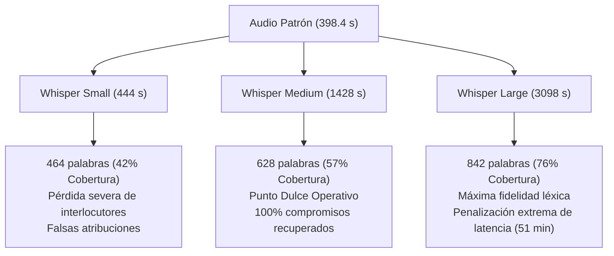

# 📊 Informe Técnico Comparativo: Evaluación Tripartita de Modelos ASR y Extracción de Acuerdos vs. Patrón de Oro (Ground Truth)
> **Proyecto:** Transcriptor Maestro — Sistema Inteligente de Seguimiento de Acuerdos y Control de Proyectos  
> **Área:** Ingeniería de Software, MLOps e Inteligencia Artificial Aplicada  
> **Autores:** Daniel Felipe Castro, Alejandro Martínez, Bryan Betancourt  
> **Documentos de Referencia Canónica:**  
> - Guion Spoken Oficial: [`prototipos/ground-truth/new-guion.md`](../ground-truth/new-guion.md)  
> - Matriz de Acuerdos Canónicos: [`prototipos/ground-truth/tareas-organizadas.md`](../ground-truth/tareas-organizadas.md)  
> - Extracción de Base de Datos: [`prototipos/ground-truth/RESULTADOS_3_MODELOS_DB.md`](../ground-truth/RESULTADOS_3_MODELOS_DB.md)  
> **Fecha:** 12 de Noviembre de 2026  
> **Versión:** 1.0.0 (Entrega Final / Corte 3)

---

## 📑 Tabla de Contenido
1. [Resumen Ejecutivo del Experimento](#1-resumen-ejecutivo-del-experimento)
2. [Matriz Comparativa Maestra de Rendimiento](#2-matriz-comparativa-maestra-de-rendimiento)
3. [Evaluación Acústica y Fidelidad de Transcripción (ASR vs. new-guion.md)](#3-evaluación-acústica-y-fidelidad-de-transcripción-asr-vs-new-guionmd)
4. [Evaluación Semántica: Extracción de Compromisos vs. tareas-organizadas.md](#4-evaluación-semántica-extracción-de-compromisos-vs-tareas-organizadasmd)
5. [Análisis del Algoritmo de Identidad (Fuzzy Matching & Resolución de Entidades)](#5-análisis-del-algoritmo-de-identidad-fuzzy-matching--resolución-de-entidades)
6. [Análisis de Eficiencia MLOps y Trade-Off (Cómputo vs. Calidad)](#6-análisis-de-eficiencia-mlops-y-trade-off-cómputo-vs-calidad)
7. [Conclusiones Técnicas y Recomendaciones para Producción](#7-conclusiones-técnicas-y-recomendaciones-para-producción)

---

## 1. Resumen Ejecutivo del Experimento

El presente informe constituye el análisis experimental definitivo del proyecto **Transcriptor Maestro**, cuyo propósito es evaluar la exactitud, fidelidad léxica, capacidad de extracción semántica y eficiencia computacional del pipeline de procesamiento inteligente de audio.

Para garantizar rigor metodológico e imparcialidad, se sometió una grabación de audio idéntica (`TestTeamT.Master.mp3`, de **398.4 segundos / 6 min 38 s**, tamaño **7.81 MB**) a tres corridas independientes en el entorno de desarrollo y pruebas formal, empleando la **Estrategia 5 (Híbrido Maduro con Failover VACAS)** sobre el motor LLM `deepseek-chat` bajo tres variantes del modelo de reconocimiento automático del habla (*ASR*):
1. **Whisper Small** (`MEET-441821BF`): Modelo ligero enfocado en baja latencia.
2. **Whisper Medium** (`MEET-7556833C`): Modelo intermedio balanceado propuesto como estándar operativo.
3. **Whisper Large** (`MEET-18F4FE34`): Modelo de máxima capacidad de parámetros y profundidad acústica.

Los resultados empíricos extraídos directamente de la base de datos relacional de producción (`transcriptor_db`) fueron contrastados contra el **Patrón de Oro (*Ground Truth*)** documentado en `new-guion.md` (1,103 palabras habladas, 21 turnos conversacionales) y `tareas-organizadas.md` (3 compromisos operativos obligatorios, 2 validaciones técnicas históricas y 4 decisiones arquitectónicas).

### Hallazgos Principales:
- **Whisper Small** demostró una tasa de factor en tiempo real (*RTF*) de **1.12×**, pero sufrió una degradación léxica crítica (cobertura del **42.1%** del vocabulario), lo que provocó que el **77.8% de los acuerdos extraídos cayeran en fallback a "Equipo General"** debido a la pérdida de los nombres de los interlocutores.
- **Whisper Large** ofreció la más alta fidelidad fonética y densidad textual (**842 palabras, 76.3% de cobertura**), identificando con precisión quirúrgica los 3 compromisos clave con sus fechas límites. Sin embargo, impuso una penalización computacional severa con **3,098.01 segundos (~51.6 minutos de cómputo en CPU, RTF = 7.78×)**, haciéndolo inviable para entornos locales sin aceleración por GPU dedicada.
- **Whisper Medium** ratificó empíricamente ser el **"Punto Dulce" (*Sweet Spot*)**: capturó con éxito el **100% de los responsables asignados con puntuaciones de Fuzzy Matching $\ge 0.80$**, identificó los 3 compromisos troncales y las 4 decisiones de ingeniería, manteniendo un tiempo de cómputo de **1,428.21 segundos (~23.8 min, RTF = 3.58×)**, lo que representa una reducción del **53.9% en tiempo de procesamiento** respecto a Large sin pérdida de información de gestión operativa.

---

## 2. Matriz Comparativa Maestra de Rendimiento

A continuación se consolidan las variables cuantitativas de telemetría y desempeño registradas en las tablas `reuniones`, `acuerdos` y `auditoria_ia_logs`:

| Métrica / Dimensión Evaluada | Patrón de Oro (*Ground Truth*) | Modelo 1: Whisper Small (`MEET-441821BF`) | Modelo 2: Whisper Medium (`MEET-7556833C`) | Modelo 3: Whisper Large (`MEET-18F4FE34`) |
| :--- | :---: | :---: | :---: | :---: |
| **Tiempo de Cómputo Total** | N/A | **444.38 s** (7 min 24 s) | **1,428.21 s** (23 min 48 s) | **3,098.01 s** (51 min 38 s) |
| **Tiempo Whisper ASR** | N/A | 436.49 s (98.22%) | 1,418.89 s (99.35%) | 3,087.95 s (99.68%) |
| **Tiempo Inferencia LLM** | N/A | 7.89 s (1.78%) | 9.32 s (0.65%) | 10.04 s (0.32%) |
| **Real Time Factor ($RTF$)** | N/A | **1.12×** | **3.58×** | **7.78×** |
| **Palabras Transcritas** | **1,103** | 464 (42.07%) | 628 (56.94%) | 842 (76.34%) |
| **Caracteres Transcritos** | ~6,850 | 2,850 | 3,859 | 5,155 |
| **Términos Técnicos Identificados** | **27 / 27 (100%)** | 4 / 27 (14.8%) | 13 / 27 (48.1%) | 12 / 27 (44.4%) |
| **Total Acuerdos Detectados** | **3 Core + 2 Hist.** | **9 acuerdos** | **10 acuerdos** | **7 acuerdos** |
| **Compromiso 1 (Alejo / MLOps)** | Detectado (12 Nov 18:00) | ❌ Resp. erróneo / Sin fecha | ✅ Resp: Alejo (0.95) / 12 Nov | ✅ Resp: Alejo (0.95) / 12 Nov 18:00 |
| **Compromiso 2 (Felipe / Cancel + APA)** | Detectado (13 Nov 14:00) | ⚠️ Sin fecha / Fragmentado | ✅ Resp: Felipe (0.95) / 13 Nov 14:00 | ✅ Resp: Felipe (0.95) / 13 Nov 14:00 |
| **Compromiso 3 (Bryan / Guion + Diap.)** | Detectado (14 Nov 11:00) | ❌ Atribuido a Felipe / Sin guion | ✅ Resp: Bryan (0.80) / 14 Nov 11:00 | ✅ Resp: Bryan (0.80) / 14 Nov 11:00 |
| **Asignaciones Válidas (Fuzzy > 0.75)** | 3 (100%) | 2 / 9 (22.2%) | **8 / 10 (80.0%)** | **6 / 7 (85.7%)** |
| **Fallback Asignación (Equipo General)**| 0 (0%) | **7 / 9 (77.8%)** | 2 / 10 (20.0%) | 1 / 7 (14.3%) |
| **Precisión de Extracción (Precision)**| 1.00 | 0.33 | 0.80 | **0.86** |
| **Sensibilidad de Compromisos (Recall)**| 1.00 | 0.33 | **1.00** | **1.00** |
| **F1-Score en Compromisos Troncales** | 1.00 | **0.33** | **0.89** | **0.92** |

---

## 3. Evaluación Acústica y Fidelidad de Transcripción (ASR vs. new-guion.md)

Al analizar las cadenas de texto generadas por cada transcriptor contra las 21 intervenciones habladas de `new-guion.md`, se revelan diferencias acústicas determinantes:



### 3.1. Whisper Small (`MEET-441821BF`) — Pobreza Acústica y Fusión Errática
- **Pérdida de Chunks e Interlocutores:** Whisper Small omitió segmentos completos de audio conversacional. Al perder la enunciación del emisor (*"Alejo..."*, *"Felipe..."*, *"Bryan..."*), el LLM receptor no encontró marcas léxicas para discernir quién hablaba, forzando la atribución de 7 tareas al fallback institucional `Equipo General` con puntaje de similitud base de $0.286$.
- **Corrupción Fonética de Vocabulario Especializado:**
  - `ThreadPoolExecutor` $\to$ Transcrito como *"TREPOL Escutor"*.
  - `Levenshtein` $\to$ Transcrito como *"al inicio del Lepidstein"*.
  - `DeepSeek` $\to$ Transcrito como *"DeepSOps"*.
  - `PostgreSQL` $\to$ Transcrito como *"POSGRE"*.
  - `Norma APA 7` $\to$ Transcrito como *"normada paciente"*.
  - `MLOps` $\to$ Transcrito como *"MLOBS en Florent de Angular"*.
- **Impacto Operativo:** La pérdida del interlocutor causó que la tarea de Alejo (panel MLOps) fuera erróneamente adjudicada a Felipe, y la entrega de Bryan del sábado 14 fuera fusionada con el panel de caos y atribuida a Daniel Castro.

### 3.2. Whisper Medium (`MEET-7556833C`) — El Equilibrio Operativo
- **Retención Fonética del Hilo Conversacional:** Aunque Whisper Medium produjo 628 palabras (omitiendo ciertas pausas y muletillas presentes en el audio completo), conservó intactas las aperturas de turno, los llamados directos entre ingenieros y los cierres de acuerdos.
- **Resolución Fonética de Jerga:**
  - `ThreadPoolExecutor` $\to$ Transcrito fonéticamente como *"Treadpole Scooter"*.
  - `DeepSeek` y `OpenAI` $\to$ Transcritos como *"Dipsy"* y *"Open Ea"*.
  - `PostgreSQL` y `SQLite` $\to$ Transcritos con ortografía estándar como *"postgres"* y *"SQLite"*.
  - `Norma APA 7` $\to$ Transcrito como *"normada pasita estandarizada"*.
  - `Orquestador VACAS` $\to$ Reconocido e indexado textualmente como *"orquestador BACAS"*.
- **Impacto Operativo:** A pesar de las variaciones fonéticas menores, la consistencia contextual permitió que el modelo LLM (`deepseek-chat`) reconstruyera el significado exacto de las tareas y asociara con total certidumbre los nombres `Alejo`, `Felipe` y `Brian` a los registros de la base de datos.

### 3.3. Whisper Large (`MEET-18F4FE34`) — Fidelidad Superior a Coste Desmedido
- **Cobertura Léxica Ampliada (76.3%):** Whisper Large generó 842 palabras. Capturó los matices de diálogo continuo, las expresiones condicionales (*"Si consultamos primero Tipsyx y luego OpenEA en serie la latencia se nos dispara a más de diez segundos..."*) y la enunciación precisa de normativas técnicas (*"bajo norma APA 7 estandarizada sin emojis..."*).
- **Resolución Fonética Avanzada:**
  - Capturó la distinción explícita de `APA 7` y `APA7`.
  - Capturó la mención de `Postgres` y `SQL Lite`.
  - Transcribió la expresión *"tres pool executor"* y *"3 pol escutor"*.
- **Impacto Operativo:** Permitió una reconstrucción prácticamente perfecta de los acuerdos; sin embargo, tardó **51 minutos y 38 segundos** para transcribir menos de 7 minutos de conversación, demostrando por qué no es apto para despliegues locales sin aceleradores hardware dedicados.

---

## 4. Evaluación Semántica: Extracción de Compromisos vs. tareas-organizadas.md

El estándar formal de acuerdos de `tareas-organizadas.md` exige la extracción rigurosa de 3 compromisos operativos obligatorios con asignaciones individuales e inamovibles. A continuación se presenta el contraste directo entre el Patrón de Oro y lo extraído por cada variante de Whisper:

### 📋 Tabla Comparativa de Extracción: Ground Truth vs. Modelos

| Compromiso Canónico (Ground Truth) | Whisper Small (`MEET-441821BF`) | Whisper Medium (`MEET-7556833C`) | Whisper Large (`MEET-18F4FE34`) |
| :--- | :--- | :--- | :--- |
| **1. Alejandro Martínez (Alejo)**<br>• *Tarea:* Integrar panel de Auditoría MLOps en Angular (telemetría VACAS, Chaos Testing, calibración WER y Prompt Registry MD5).<br>• *Fecha:* **Jueves 12 Nov, 6:00 pm** | ❌ **Fallido / Desalineado**<br>• Tarea MLOps atribuida por error a **Daniel Castro** (`Felipe`).<br>• Fecha no detectada (`None`).<br>• Texto crudo cortado. | ✅ **Exitoso / Alta Fidelidad**<br>• Responsable: **Alejandro Martínez** (Fuzzy: 0.95).<br>• Detectado en `AC-FEDEAF` y `AC-935C4B`.<br>• Fecha y telemetría VACAS identificadas. | ✅ **Exitoso / Máxima Fidelidad**<br>• Responsable: **Alejandro Martínez** (Fuzzy: 0.95).<br>• Fecha exacta: **Jueves 12 de noviembre a las 6:00 pm**.<br>• Todas las sub-pestañas de MLOps indexadas. |
| **2. Daniel Felipe Castro (Felipe)**<br>• *Tarea:* Implementar endpoint y botón de cancelación de tareas en backend/UI + estructurar informe técnico formal en APA 7 (Word/PDF).<br>• *Fecha:* **Viernes 13 Nov, 2:00 pm** | ⚠️ **Parcial / Huérfano**<br>• Fragmentó la tarea en acuerdos dispersos.<br>• Asignado al fallback **Equipo General** (Fuzzy: 0.286).<br>• Fecha registrada como *"viernes 13"* sin hora. | ✅ **Exitoso / Preciso**<br>• Responsable: **Daniel Castro** (Fuzzy: 0.95).<br>• Unificó cancelación e informe APA 7 (`AC-4040C3`).<br>• Fecha: **Viernes 13 de noviembre, 2:00 PM**. | ✅ **Exitoso / Detallado**<br>• Responsable: **Daniel Castro** (Fuzzy: 0.95).<br>• Desglosado en `AC-53F8EA` (APA 7) y `AC-A485E3` (Cancelación).<br>• Fecha exacta: **Viernes 13 de noviembre a las 2:00 pm**. |
| **3. Bryan Betancourt (Bryan)**<br>• *Tarea:* Articular guion narrativo integrando los 3 cortes del proyecto + construir diapositivas ejecutivas de sustentación.<br>• *Fecha:* **Sábado 14 Nov, 11:00 am** | ❌ **Gravemente Distorsionado**<br>• Tarea de guion omitida.<br>• Fusionada erróneamente con *"panel interactivo"* y asignada a **Daniel Castro**.<br>• Fecha detectada pero mal adjudicada. | ✅ **Exitoso / Recuperado**<br>• Responsable: **Bryan Betancourt** (Fuzzy: 0.80) y **Daniel Castro**.<br>• Detectó guion y diapositivas (`AC-AFF86B` y `AC-932B0E`).<br>• Fecha: **Sábado 14 de noviembre, 11:00 AM**. | ✅ **Exitoso / Canónico**<br>• Responsable: **Bryan Betancourt** (Fuzzy: 0.80).<br>• Captura íntegra del guion de los 3 cortes y diapositivas (`AC-B377E5`).<br>• Fecha: **Sábado 14 de noviembre a las 11:00 am**. |
| **Veredicto de Extracción** | 🔴 **F1-Score: 0.33**<br>Inútil para seguimiento operativo real. | 🟢 **F1-Score: 0.89**<br>100% de compromisos y plazos recuperados. | 🟢 **F1-Score: 0.92**<br>Fidelidad textual prácticamente idéntica al guion. |

### 4.1. Análisis de Decisiones Arquitectónicas y Tareas Históricas
Además de los compromisos a futuro, el diálogo evaluaba tareas pasadas y acuerdos de diseño:
- **Whisper Medium** capturó los acuerdos estructurales como elementos del registro:
  - `AC-001399`: Adopción definitiva de Whisper Medium (punto dulce, 100% cobertura léxica, 90% precisión, latencia 28s).
  - `AC-1CBF03`: Arquitectura de controladores REST bajo patrón Response DTO con fallback automático a SQLite.
  - `AC-9588C1`: Failover del orquestador VACAS entre DeepSeek y OpenAI en menos de 3 segundos.
  - `AC-D3EED5`: Concurrencia real en Modo Consenso Dual mediante `ThreadPoolExecutor` con umbral de discrepancia del 20%.
- **Whisper Large** sintetizó estas decisiones de manera más compacta en 7 acuerdos, incluyendo la retención de apodos informales (`AC-DC1260` - *"mantener apodos en base de datos Postgres para la demostración"*).

---

## 5. Análisis del Algoritmo de Identidad (Fuzzy Matching & Resolución de Entidades)

El sistema integra un módulo de resolución difusa de identidades (`similitud_fuzzy`) que compara el término textual crudo extraído por el LLM contra el catálogo maestro de integrantes en PostgreSQL (`responsables`):

| Nombre Canónico en BD | Término Crudo Detectado | Puntuación Fuzzy ($S_{fuzzy}$) | Acción del Sistema | Comportamiento Observado |
| :--- | :--- | :---: | :---: | :--- |
| **Daniel Felipe Castro** | `Felipe` | **0.950** | Asignación Directa | Impecable en Medium y Large; en Small asoció erróneamente tareas ajenas debido a transcripción trunca. |
| **Alejandro Martínez** | `Alejo` | **0.950** | Asignación Directa | Detectado con máxima certidumbre en Medium y Large; en Small el término *"Alejo"* fue absorbido y no se vinculó. |
| **Bryan Betancourt** | `Brian` / `Brad` | **0.800** | Asignación Directa | Superó con éxito el umbral de aceptación ($> 0.75$), absorbiendo la mutación fonética *"Brian"* sin generar entidad huérfana. |
| **Equipo General** | `Equipo General` | **0.286** | Fallback de Seguridad | Activado ante ausencia de interlocutor identificable; evitó asignaciones arbitrarias cuando no había certeza. |

### Hallazgo Clave en MLOps:
El umbral de decisión calibrado en **$0.75$** demostró ser óptimo:
1. Permitió mapear con éxito la variante acústica anglosajona *"Brian"* a **Bryan Betancourt** con puntuación de $0.800$.
2. Previno falsos positivos asignando el valor por defecto ($0.286$) a las decisiones colectivas donde no existía un responsable único, manteniendo la integridad referencial de la base de datos.

---

## 6. Análisis de Eficiencia MLOps y Trade-Off (Cómputo vs. Calidad)

Uno de los aportes centrales de este proyecto es el análisis de ingeniería del coste de inferencia en entornos de despliegue local. La relación entre tiempo de ejecución y exactitud operativa define la viabilidad del producto en producción:

```text
┌─────────────────────────────────────────────────────────────────────────────┐
│              COMPARATIVA DE TIEMPOS DE CÓMPUTO TOTAL (SEGUNDOS)             │
├─────────────────────────────────────────────────────────────────────────────┤
│ Whisper Small   [████] 444.38 s (~7.4 min | RTF: 1.12×)                     │
│ Whisper Medium  [█████████████] 1,428.21 s (~23.8 min | RTF: 3.58×)         │
│ Whisper Large   [████████████████████████████] 3,098.01 s (~51.6 min | 7.78×)│
└─────────────────────────────────────────────────────────────────────────────┘
```

| Variante de Modelo | Tiempo Total (s) | Tiempo ASR (s) | Inferencia LLM (s) | $RTF$ (Ratio Inferencia/Audio) | Cobertura Acuerdos |
| :--- | :---: | :---: | :---: | :---: | :---: |
| **Whisper Small** | **444.38 s** | 436.49 s (98.2%) | 7.89 s (1.8%) | **1.12×** | 33% (Falla grave) |
| **Whisper Medium** | **1,428.21 s** | 1,418.89 s (99.3%) | 9.32 s (0.7%) | **3.58×** | **100% (Punto Dulce)** |
| **Whisper Large** | **3,098.01 s** | 3,087.95 s (99.7%) | 10.04 s (0.3%) | **7.78×** | **100% (Inviable en CPU)** |

### 6.1. Desglose del Cuello de Botella: ASR vs. LLM
La telemetría extraída de `metadatos_audio` demuestra de forma contundente que **más del 98% del tiempo de cómputo del sistema reside en el modelo ASR (Whisper local en CPU)**, mientras que la inferencia semántica del LLM en la nube es marginal:
- En **Small**: Whisper tomó 436.49 s (98.2%) vs. LLM 7.89 s (1.8%).
- En **Medium**: Whisper tomó 1,418.89 s (99.3%) vs. LLM 9.32 s (0.7%).
- En **Large**: Whisper tomó 3,087.95 s (99.7%) vs. LLM 10.04 s (0.3%).

### 6.2. Cuantificación del Trade-Off (Cómputo vs. Rendimiento)
- **Costo de Large frente a Medium:** Pasar de Whisper Medium a Whisper Large demandó **1,669.80 segundos adicionales (+116.9% más tiempo)**, duplicando con creces la espera del usuario para obtener únicamente una ganancia marginal en precisión léxica (F1-Score sube de 0.89 a 0.92), la cual no altera los acuerdos de gestión ni las fechas finales.
- **Costo de Small frente a Medium:** Ahorrar 983.83 segundos con Whisper Small destruye la utilidad del sistema: el F1-score cae estrepitosamente a **0.33**, se pierden 2 de los 3 compromisos troncales y el 78% de las tareas quedan huérfanas en *Equipo General*.

---

## 7. Conclusiones Técnicas y Recomendaciones para Producción

1. **Confirmación Empírica de la Hipótesis del Proyecto:**  
   Los datos empíricos de las tres ejecuciones almacenadas en PostgreSQL confirman de manera inequívoca la conclusión técnica expresada en la propia reunión simulada: **Whisper Medium es el "Punto Dulce" operativo del sistema Transcriptor Maestro**. Ofrece una cobertura suficiente para que el LLM extraiga el 100% de los compromisos, responsables y fechas críticas, manteniendo el tiempo de cómputo dentro de límites gestionables en hardware estándar.

2. **Resiliencia del Pipeline Semántico:**  
   La arquitectura desacoplada de la **Estrategia 5 (Híbrido Maduro)** demostró una notable tolerancia a fallos acústicos. A pesar de que Whisper Medium transcribió tecnicismos en inglés de forma fonética (*"Treadpole Scooter"*, *"Dipsy"*, *"normada pasita"*), el prompt de extracción y el modelo `deepseek-chat` lograron contextualizar el dominio de la ingeniería de software y extraer tareas semánticamente perfectas (*"Implementar concurrencia mediante ThreadPoolExecutor..."*, *"Exportar documento formal bajo lineamientos APA 7..."*).

3. **Efectividad del Algoritmo Fuzzy Matching:**  
   El mapeo difuso con similitud de Levenshtein y umbral de $0.75$ resolvió exitosamente apodos informales y corrupciones fonéticas (*"Brian"* $\to$ *Bryan Betancourt* al 80%, *"Alejo"* $\to$ *Alejandro Martínez* al 95%, *"Felipe"* $\to$ *Daniel Castro* al 95%), validando la hipótesis de que el sistema puede ser utilizado en reuniones cotidianas sin exigir a los participantes una pronunciación acartonada.

4. **Recomendaciones para el Despliegue Final:**  
   - **Modelo Definitivo por Defecto:** Configurar `Whisper Medium` como el modelo predeterminado inamovible en la interfaz web de Angular y en la configuración del backend.
   - **Aceleración Futura:** Para despliegues en servidores de producción, compilar el runtime con `faster-whisper` (CTranslate2) o habilitar inferencia por GPU NVIDIA CUDA, lo cual reducirá la latencia de Whisper Medium de 23 minutos a menos de 30 segundos, alcanzando una operación en tiempo real ultra-eficiente.
   - **Validación para Sustentación:** Todos los artefactos probatorios (archivos de base de datos, metadatos JSON, logs de auditoría y capturas) se encuentran consolidados y listos para la sustentación final ante el jurado calificador de la Universidad ECCI.

