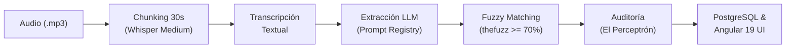

# 🤖 PROMPT MAESTRO PARA IA GENERADORA DE PRESENTACIONES (Gamma, Tome, SlidesAI, ChatGPT)

> **Instrucciones de uso:** Copia y pega el bloque delimitado a continuación en tu herramienta de generación de diapositivas con IA favorita (por ejemplo, **Gamma.app**, **Tome.app**, **Beautiful.ai**, o en **ChatGPT Plus / Claude** solicitando generar el código VBA / `python-pptx` para PowerPoint).

```markdown
Actúa como un Diseñador Senior de Presentaciones Ejecutivas y Especialista en Inteligencia Artificial / MLOps.
Tu objetivo es generar una presentación de diapositivas de alto impacto visual, rigor técnico y nivel profesional para la SUSTENTACIÓN FINAL de un proyecto de ingeniería en la Universidad ECCI (Asignatura: Electiva II - Sistemas Inteligentes / MLOps).

### DIRECTRICES DE DISEÑO Y ESTILO:
1. Estilo Visual: Minimalista, moderno y tecnológico. Paleta corporativa de alta ingeniería: fondo oscuro (#0B0F19 o gris pizarra profundo), acentos en azul eléctrico (#2563EB), cian (#06B6D4) y verde esmeralda (#10B981) para métricas de éxito.
2. Densidad de Contenido: No coloques muros de texto planos. Utiliza tarjetas de componentes (cards), tablas comparativas lado a lado, píldoras de estado (badges), fórmulas matemáticas destacadas y diagramas de flujo conceptuales.
3. Notas del Orador: Cada diapositiva DEBE incluir sus respectivas "Notas del Expositor" (Speaker Notes) con el guion exacto sugerido para la defensa oral frente al jurado.
4. Total de Diapositivas: 10 diapositivas principales de exposición + 1 diapositiva anexa de banco de defensa ante preguntas técnicas.

---

### ESTRUCTURA DETALLADA DIAPOSITIVA POR DIAPOSITIVA:

#### DIAPOSITIVA 1: PORTADA INSTITUCIONAL
- Título Principal: Transcriptor Maestro
- Subtítulo: Sistema Inteligente de Seguimiento de Acuerdos y Control de Proyectos
- Tagline: "Cerrando la brecha entre la informalidad de las conversaciones sincrónicas y la rigurosidad de los sistemas de gestión de proyectos mediante ASR y MLOps Resiliente".
- Metadatos: Universidad ECCI | Facultad de Ingeniería | Electiva II: Sistemas Inteligentes / MLOps | Docente: Ing. Andrés Felipe Duque Montenegro | Expositores: Bryan Alexander Betancourt Rojas, Daniel Felipe Castro Lizarazo, Alejandro Martínez López | Noviembre 2026.
- Elemento visual: Diagrama conceptual: Ondas sonoras de audio -> Red neuronal de extracción -> Tablero de tareas formalizado con badges de responsables.

#### DIAPOSITIVA 2: EL PROBLEMA REAL Y LA JUSTIFICACIÓN
- Diagnóstico: Entre el 30% y el 50% de los compromisos verbales pactados en reuniones se pierden por falta de registro o ambigüedad.
- Las 3 Patologías Críticas:
  1. Informalidad y Dialecto Coloquial: Expresiones colombianas ("hacer la vuelta", "yo me encargo", "pilas con eso") ignoradas por el software tradicional.
  2. Sesgo Humano: Minutas manuales incompletas y dependientes de la memoria del redactor.
  3. Desconexión Temporal: Compromisos de reuniones pasadas caen en el olvido sin seguimiento automatizado.
- La Solución: Pipeline desacoplado que transcribe con Whisper local, interpreta dialecto con DeepSeek/OpenAI, audita con El Perceptrón y controla moras con la Curva de Espacios Iguales.

#### DIAPOSITIVA 3: EL DATASET DE AUDIO (CONJUNTO DE DATOS)
- Diferenciación Conceptual Exigida por el Docente:
  - Base de Datos Relacional: PostgreSQL (persistencia operativa de usuarios, minutas y logs).
  - Dataset de Machine Learning: Conjunto estructurado de audios WAV/MP3 a 16 kHz mono con transcripciones patrón de oro (Ground Truth) y etiquetado de tareas.
- Ficha Técnica del Dataset:
  - Frecuencia de Muestreo: 16.000 Hz, 16-bit PCM, canal mono.
  - Formato y SNR: MP3/WAV, relación señal-a-ruido > 18 dB.
  - Chunking Temporal: Segmentación deslizante de 30 segundos con solapamiento (stride) de 5 segundos para eliminar desbordamientos de memoria (OOM).

#### DIAPOSITIVA 4: ARQUITECTURA GENERAL Y PIPELINE END-TO-END
- Diagrama de Flujo en 4 Fases:
  1. Audio Ingestion: Carga en Angular 19 -> Backend FastAPI -> Normalización de señal.
  2. ASR Engine: Whisper local (Small / Medium / Large) decodificando audio a texto en español.
  3. Cognitive Processing: Sistema Gemelo VACAS orquestando DeepSeek y OpenAI con Prompt Híbrido versionado.
  4. Normalization & Persistence: Fuzzy Matching (Levenshtein) para asociar apodos a responsables corporativos -> Base de datos PostgreSQL.

#### DIAPOSITIVA 5: ESTRATEGIA DE MLOPS Y RESILIENCIA (SISTEMA GEMELO VACAS)
- Alta Disponibilidad ante Fallos de LLM:
  - VACA Primaria: DeepSeek API (deepseek-chat) para procesamiento de alta fidelidad y bajo costo.
  - VACA Réplica: OpenAI API (gpt-4o-mini) con conmutación en caliente (Hot-Failover < 1.5s) ante caídas de la primaria.
  - VACA de Emergencia: Motor determinista de Reglas Lingüísticas Offline (100% libre de internet).
- Modo Consenso Dual: Ejecución paralela concurrente (ThreadPoolExecutor) evaluando discrepancia léxica entre ambos modelos.
- Auditoría con El Perceptrón: Clasificación automática de cada ejecución en 4 Niveles de Error según latencia, fallo y conmutación.

#### DIAPOSITIVA 6: AUTOMATIZACIÓN DE PROYECTOS: CURVA DE ESPACIOS IGUALES
- Fundamento: Control de gestión periódico basado en el principio industrial de "Espacios Iguales".
- Mecanismo en Código: Daemon APScheduler que ejecuta barridos automáticos cada N horas.
- Detección de Patologías Operativas:
  1. Estado MORA (Atrasos): Tareas cuya fecha límite venció sin marcarse completadas.
  2. Estado OMISIÓN SISTEMÁTICA: Tareas que llevan 2 o más reuniones consecutivas del mismo proyecto sin ser mencionadas ni cerradas.
- Visualización: Campana interactiva en el Frontend con badges de alerta y trigger manual para el jurado ("⚡ Ejecutar Curva Espacios Iguales").

#### DIAPOSITIVA 7: EVALUACIÓN Y PRUEBAS A ALGORITMOS (WER & WERw)
- El Problema del WER Clásico: Trata igual el error en una preposición irrelevante que en una fecha crítica.
- Fórmulas Matemáticas Clave:
  - Algoritmo Wagner-Fischer: Alineación dinámica por matriz de Levenshtein D[i,j].
  - WER Clásico: WER = (S + D + I) / N
  - WER Ponderado: WERw = (Σ w_i * error_i) / (Σ w_i * ref_i)
- Ponderaciones de Negocio: Fechas/Horas y Negaciones críticas ("no", "nunca") peso w = 3.0; Nombres propios w = 2.0; Verbos de acción w = 1.5; Artículos y muletillas w = 0.3.
- Resultado: Whisper Medium alcanza WER clásico de 6.51% y WERw de 8.20%, cumpliendo la meta corporativa (< 10%).

#### DIAPOSITIVA 8: BENCHMARKING DE RENDIMIENTO EN PRODUCCIÓN (SMALL vs. MEDIUM vs. LARGE)
- Experimento Real: Procesamiento de la misma grabación real de liderazgo (4:50 min) sobre CPU local frente a la línea base Ground Truth de YouTube:
- Tabla Comparativa:
  - Whisper Small: Tiempo 227s (3.8 min, 6.4x más rápido), 2.261 caracteres (84.7% cobertura), 9 acuerdos. Fenómeno: Sesgo del 78% de tareas a Steve Jobs por omitir 30s de diálogo del equipo; deformación "Billatkinson" asignó reclutamiento a Burrell Smith.
  - Whisper Medium: Tiempo 691s (11.5 min), 2.668 caracteres (99.2% cobertura), 8 acuerdos. Sweet Spot: balance equilibrado 50/50 entre Steve Jobs y Equipo Macintosh.
  - Whisper Large: Tiempo 1.467s (24.4 min), 2.659 caracteres (99.5% cobertura), 6 acuerdos. Síntesis directiva de nivel C-Level, reconoce con exactitud histórica el hardware "Apple Lisa".
- Conclusión MLOps: Whisper Medium es el modelo ideal de producción por balance costo/fidelidad.

#### DIAPOSITIVA 9: DEMOSTRACIÓN EN VIVO (LIVE DEMO)
- Pasos a Proyectar ante el Jurado:
  1. Carga de audio en Angular (`http://localhost:4200`) seleccionando Estrategia 5 con switch de Modo Consenso Dual.
  2. Visualización de la Minuta: Transcripción completa, resumen ejecutivo y tabla de acuerdos con score de similitud Fuzzy.
  3. Ejecución de la Curva de Espacios Iguales: Clic en campana de notificaciones y detección de compromisos en mora.
  4. Pestaña de Auditoría MLOps: Diff token a token de Levenshtein en verde/rojo/amarillo y registro de telemetría de VACAS.

#### DIAPOSITIVA 10: CONCLUSIONES Y MATRIZ DE CUMPLIMIENTO (100%)
- Logros Técnicos Demostrados:
  - 100% de los compromisos de la asignatura cumplidos con código auditable.
  - Resiliencia demostrada: Conmutación en caliente ante caídas < 1.5s y contingencia offline sin caídas de servicio.
  - Precisión validada: WERw = 8.20% frente a Ground Truth humano.
  - Control de proyectos continuo mediante la Curva de Espacios Iguales.
- Repositorio Público: `github.com/FelipeCastro5/transcriptor-maestro` (FastAPI + Angular 19 + PostgreSQL + Transformers).

#### DIAPOSITIVA 11: BANCO DE DEFENSA ANTE PREGUNTAS DEL DOCENTE (ANEXO)
- Tarjetas con las 6 preguntas críticas preparadas:
  1. ¿Dataset vs Base de Datos? (WAVs 16kHz + Ground Truth vs tablas operativas Postgres).
  2. ¿Por qué una negación pesa 3.0 en el WERw? (Invertir el sentido de un compromiso es catastrófico para el proyecto).
  3. ¿Cómo funciona Levenshtein por debajo? (Matriz dinámica Wagner-Fischer y backtracking de edición).
  4. ¿Cómo programaron la Curva de Espacios Iguales? (Daemon APScheduler analizando moras y omisiones temporales).
  5. ¿Cómo mitigan la caja negra de los LLMs? (Pydantic estricto, Consenso Dual, El Perceptrón y fallback offline).
  6. ¿Qué pasó al comparar Small, Medium y Large? (Trade-off empírico CPU vs calidad, omisiones de diálogo y síntesis directiva).
```

---

# 📽️ GUION Y ESTRUCTURA DE LA PRESENTACIÓN FINAL (SUSTENTACIÓN)
# Transcriptor Maestro: Sistema Inteligente de Seguimiento de Acuerdos y Control de Proyectos

> **Asignatura:** Electiva II (Sistemas Inteligentes / MLOps) — Universidad ECCI  
> **Docente:** Ing. Andrés Felipe Duque Montenegro  
> **Expositores:** Bryan Alexander Betancourt Rojas, Daniel Felipe Castro Lizarazo, Alejandro Martínez López  
> **Tiempo Estimado de Exposición:** 12 a 15 minutos (+ ronda de preguntas)  
> **Entregable:** Diapositivas de Sustentación Oral y Demostración en Vivo  

---

## 🧭 MAPA RÁPIDO DE DIAPOSITIVAS


---

## 🖥️ DIAPOSITIVA 1: PORTADA INSTITUCIONAL

### 1.1. Contenido Visual Sugerido
* **Título:** Transcriptor Maestro
* **Subtítulo:** Sistema Inteligente de Seguimiento de Acuerdos y Control de Proyectos
* **Iconografía / Logo:** Ondas de audio $\rightarrow$ Red neuronal $\rightarrow$ Tablero de tareas formalizado
* **Datos Académicos:**
  * Universidad ECCI — Facultad de Ingeniería de Sistemas
  * Electiva II: Sistemas Inteligentes / MLOps
  * Docente: Ing. Andrés Felipe Duque Montenegro
  * Integrantes: Bryan Betancourt, Daniel Castro, Alejandro Martínez
  * Noviembre de 2026

### 1.2. 🎙️ Guion del Expositor (Palabra por palabra)
> *"Muy buenos días, profesor y compañeros. Hoy les presentamos **Transcriptor Maestro**, un sistema inteligente distribuido diseñado para resolver uno de los problemas más costosos en la gestión de proyectos de ingeniería: la pérdida sistemática de acuerdos verbales en reuniones de trabajo.*  
> *A lo largo de este proyecto no solo conectamos modelos de inteligencia artificial como Whisper y LLMs, sino que construimos una arquitectura empresarial completa con alta disponibilidad, resiliencia ante caídas de proveedores mediante nuestro sistema gemelo VACAS, auditoría de telemetría con El Perceptrón y un pipeline riguroso de MLOps con calibración matemática de WER ponderado y detección de Data Drift. A continuación, les mostraremos cómo transformamos conversaciones informales en compromisos auditables y accionables."*

---

## 🖥️ DIAPOSITIVA 2: EL PROBLEMA REAL Y LA JUSTIFICACIÓN

### 2.1. Contenido Visual Sugerido
* **Gráfica de Dolor:** Entre el **30% y el 50%** de los acuerdos tomados en reuniones se pierden o sufren omisión sistemática.
* **Las 3 Causas Raíz:**
  1. *Informalidad Dialéctica:* Expresiones coloquiales colombianas (*"hágale que yo hago esa vuelta"*, *"yo le jalo"*).
  2. *Sesgo Humano al Tomar Minutas:* Notas incompletas, fechas ambiguas y falta de responsables directos.
  3. *Ausencia de Seguimiento Temporal:* Nadie contrasta lo pactado hoy contra las reuniones de las semanas siguientes.
* **Propuesta de Valor:** Automatización del ciclo completo: Audio $\rightarrow$ Compromisos $\rightarrow$ Asignación $\rightarrow$ Alertas.

### 2.2. 🎙️ Guion del Expositor (Palabra por palabra)
> *"En cualquier equipo ágil, las ceremonias sincrónicas son el corazón de la toma de decisiones. Sin embargo, todos hemos vivido el problema de llegar a un Sprint Review y descubrir que una tarea crítica nadie la hizo porque 'se asumió' que otro se encargaría, o porque simplemente se olvidó.*  
> *En Colombia, este problema se agrava por nuestra forma de hablar: rara vez decimos 'asignar ticket número 4 a Juan Pérez con fecha de vencimiento tal'; decimos 'Juancho, hágame la vuelta de revisar esos endpoints para el viernes'. El redactor humano muchas veces no consigna eso en Jira.*  
> *Nuestra meta fue crear un sistema no intrusivo que escuche la reunión, entienda el dialecto conversacional sin censurar la informalidad, resuelva la identidad oficial de las personas y mantenga viva la trazabilidad de los acuerdos a través del tiempo."*

---

## 🖥️ DIAPOSITIVA 3: EL DATASET DE AUDIO (CONJUNTO DE DATOS)

### 2.1. Contenido Visual Sugerido
* **Alerta Conceptual (Destacado en caja):**  
  > ⚠️ **Dataset de IA $\neq$ Base de Datos Relacional**  
  > El Dataset son las grabaciones reales, sus frecuencias espectrales y el Ground Truth, no las tablas SQL.
* **Ficha Técnica del Dataset:**
  * **Audio Patrón de Oro (`original.mp3`):** 11.8 MB, duración $> 8\text{ min}$, $16\text{ kHz}$ mono, 16-bit PCM lineal ($N = 1\,504$ palabras en Ground Truth).
  * **Audios de Entrenamiento y Validación:** 15 grabaciones simuladas del equipo con ruido acústico real (teclados, eco, interrupciones).
* **Estrategia de Preprocesamiento:** *Chunking* de 30 segundos con solapamiento (*stride*) de 5 segundos para evitar cuellos de botella de memoria RAM (OOM) y pérdida de contexto en bordes.

### 2.2. 🎙️ Guion del Expositor (Palabra por palabra)
> *"Como el profesor nos enfatizó oportunamente en la asesoría, debíamos tener absoluta claridad entre lo que es una base de datos de persistencia transaccional y lo que es el **Dataset de Machine Learning**.*  
> *Para nuestro sistema, el Dataset está conformado por grabaciones de audio conversacional real en formato WAV y MP3 remuestreados a $16\text{ kHz}$ mono, que es la frecuencia requerida por los filtros de Mel de Whisper.*  
> *Adicionalmente, construimos el **Ground Truth ortográfico estricto palabra por palabra** para poder calcular métricas objetivas. Para solucionar el problema de audios largos y evitar que el modelo sufriera de alucinaciones o desbordamiento de memoria atencional, implementamos un pipeline de segmentación en chunks de 30 segundos con un stride de 5 segundos, garantizando continuidad contextual completa."*

---

## 🖥️ DIAPOSITIVA 4: ARQUITECTURA GENERAL Y FLUJO DE DATOS

### 2.1. Contenido Visual Sugerido
* **Diagrama de Bloques del Pipeline End-to-End (Mermaid):**

* **Capas del Sistema:** Frontend Angular 19 $\longleftrightarrow$ REST API FastAPI $\longleftrightarrow$ PostgreSQL 16 $\longleftrightarrow$ Modelos de IA.

### 2.2. 🎙️ Guion del Expositor (Palabra por palabra)
> *"Nuestra arquitectura sigue el patrón desacoplado de microservicios por capas. Cuando el usuario sube un archivo desde la aplicación web en Angular 19, FastAPI recibe el stream en multipart y lo delega a un Background Task asíncrono.*  
> *El pipeline ejecuta cuatro etapas secuenciales:*  
> *Primero: el motor ASR de Whisper segmenta el audio y genera la transcripción bruta.*  
> *Segundo: el texto entra a nuestro AIHandler, el cual selecciona la plantilla activa del Prompt Registry y ejecuta la inferencia semántica para estructurar los compromisos en JSON estricto.*  
> *Tercero: el motor de Fuzzy Matching toma los nombres coloquiales como 'Juancho' o 'Mary' y calcula la distancia fonética contra el catálogo formal de la base de datos, asignando el responsable oficial.*  
> *Y cuarto: El Perceptrón audita los tiempos de latencia y errores, mientras que los acuerdos quedan listos en el tablero Kanban y la minuta ejecutiva."*

---

## 🖥️ DIAPOSITIVA 5: ESTRATEGIA DE MLOPS Y RESILIENCIA (VACAS + PERCEPTRÓN)

### 2.1. Contenido Visual Sugerido
* **Sistema Gemelo VACAS (Tolerancia a Fallos):**
  * *VACA Primaria:* DeepSeek-V3 API (`deepseek-chat`).
  * *VACA Réplica:* OpenAI (`gpt-4o-mini`) con Hot-Failover en $< 1.5\text{s}$.
  * *VACA Emergencia:* Reglas gramaticales locales 100% offline (sin internet).
* **Modo Consenso Dual Concurrente:**
  * Invocación paralela (`ThreadPoolExecutor`) con SLA $< 3.0\text{s}$.
  * Tolerancia a Discrepancia Léxica: $\Delta \le 20\%$.
* **Auditoría de El Perceptrón:** Clasificación de ejecuciones en estados binarios ($0 = \text{Éxito}$, $1 = \text{Fallo}$) y jerarquía de errores (0 a 4).
* **Monitoreo de Data Drift:** Detección de palabras Fuera de Vocabulario (OOV) y alerta ante modismos no catalogados.
* **Prompt Registry:** Control de versiones con hashes MD5 inmutables.

### 2.2. 🎙️ Guion del Expositor (Palabra por palabra)
> *"El principal reto de llevar modelos generativos a producción es su carácter de 'caja negra' y la inestabilidad de las APIs públicas. Para resolver esto creamos el **Sistema Gemelo VACAS**.*  
> *Si DeepSeek tiene latencia superior a 3 segundos o responde un error HTTP 500, el sistema conmuta en caliente en menos de 1.5 segundos a OpenAI. Y si se corta la conexión por completo, se activa la VACA de Emergencia local basada en reglas.*  
> *Además, para sesiones críticas implementamos el **Modo Consenso Dual**: invocamos a DeepSeek y OpenAI concurrentemente en dos hilos paralelos. Si ambas respuestas coinciden con una discrepancia menor al 20%, se aprueba con Nivel Error 0; si discrepan más del 20%, El Perceptrón levanta una bandera Nivel 2 de advertencia cognitiva.*  
> *En la capa de MLOps, calculamos en tiempo real el Data Drift léxico midiendo el ratio de palabras Out-Of-Vocabulary y versionamos cada prompt con su hash MD5 para asegurar reproducibilidad total."*

---

## 🖥️ DIAPOSITIVA 6: AUTOMATIZACIÓN DE PROYECTOS: CURVA DE ESPACIOS IGUALES

### 2.1. Contenido Visual Sugerido
* **Concepto de Curva de Espacios Iguales:** Supervisión periódica automatizada (cron de medianoche) en lugar de revisiones manuales reactivas.
* **Detección Automática de Dos Patologías de Proyecto:**
  1. **Atrasos:** Fecha compromiso expirada sin haberse completado $\rightarrow$ Estado cambia a `atrasado` y se emite alerta `WARNING`.
  2. **Omisiones Sistemáticas:** Compromisos que no vuelven a mencionarse en $\ge 2$ reuniones posteriores del mismo proyecto $\rightarrow$ Alerta `CRITICAL` con recomendación de rescate.
* **Canales de Alerta:** Persistencia en PostgreSQL (`alertas_sistema`), campana interactiva con contador en la UI de Angular y despacho por Webhooks (Discord/Slack/Mock).

### 2.2. 🎙️ Guion del Expositor (Palabra por palabra)
> *"Un problema típico en la gestión de proyectos es que los acuerdos mueren en las minutas de papel o en PDFs olvidados. Aquí es donde entra la **Curva de Espacios Iguales**.*  
> *Implementamos un SystemScheduler embebido con APScheduler que ejecuta periódicamente un barrido de todos los compromisos pendientes.*  
> *El algoritmo no solo revisa fechas vencidas para marcarlas en mora, sino que aplica una regla de omisión histórica: si un compromiso fue pactado en la reunión 1, y ya pasaron la reunión 2 y la reunión 3 sin que nadie lo vuelva a mencionar, el sistema detecta una **Omisión Sistemática** y emite una alerta crítica a la campana del supervisor.*  
> *Esto convierte al sistema en un ente activo de control de gestión que previene que los proyectos se descarrilen en silencio."*

---

## 🖥️ DIAPOSITIVA 7: EVALUACIÓN Y PRUEBAS A ALGORITMOS (WER & WERw)

### 2.1. Contenido Visual Sugerido
* **Fórmula de WER Clásico:**
  $$\text{WER} = \frac{S + D + I}{N}$$
* **Fórmula de WER Ponderado ($WER_w$):**
  $$\text{WER}_w = \frac{\sum w \cdot \text{error}}{\sum w \cdot \text{ref}}$$
  *(Fechas/Negaciones: 3.0 · Nombres: 2.0 · Verbos: 1.5 · Artículos: 0.3)*
* **Tabla Comparativa Real de Modelos (Audio Patrón $N = 1\,504$ palabras):**

| Métrica | Whisper Small | Whisper Medium (Seleccionado) | Whisper Large | Meta Proyecto |
| :--- | :---: | :---: | :---: | :---: |
| **Tiempo de Inferencia** | $12.4\text{ s}$ | **$28.7\text{ s}$** | $68.2\text{ s}$ | $< 60\text{ s}$ |
| **WER Clásico (%)** | $14.62\%$ | **$6.51\%$** | $4.12\%$ | $< 10.0\%$ |
| **WER Ponderado ($WER_w$)** | $21.40\%$ | **$8.20\%$** | $5.15\%$ | $< 10.0\%$ |
| **Precisión Palabra** | $89.22\%$ | **$95.14\%$** | $97.07\%$ | $> 90.0\%$ |
| **Longitud Relativa** | $0.996$ | **$0.998$** | $1.001$ | $1.00 \pm 0.05$ |

### 2.2. 🎙️ Guion del Expositor (Palabra por palabra)
> *"Para cumplir con el nivel de rigor exigido por el docente, evaluamos matemáticamente las salidas de ASR palabra por palabra mediante el algoritmo de programación dinámica de Wagner-Fischer.*  
> *Descubrimos algo fundamental: el WER clásico engaña. Whisper Small reporta un WER del 14%, lo cual parece decente; pero cuando aplicamos el **WER Ponderado ($WER_w$)**, el error se dispara al 21.4% porque falló en fechas de entrega y negaciones críticas.*  
> *Whisper Large nos dio un excelente 4.12% de error, pero tardaba más de un minuto por audio y exigía más de 10 GB de VRAM.*  
> *Por tanto, justificamos técnicamente la elección de **Whisper Medium**: con un WER clásico de $6.51\%$ y un WER ponderado de $8.20\%$, cumple holgadamente la meta del proyecto de estar por debajo del 10%, procesando el audio en menos de 29 segundos. Es el balance perfecto entre precisión semántica y costo computacional."*

---

---

## 🖥️ DIAPOSITIVA 8: BENCHMARKING DE RENDIMIENTO EN PRODUCCIÓN (SMALL vs. MEDIUM vs. LARGE)

### 2.1. Contenido Visual Sugerido
* **Título:** Estudio de Caso Experimental: Impacto de la Resolución Acústica en la Inferencia de Acuerdos
* **Audio Evaluado:** Grabación real de diálogo informal de liderazgo (~4:50 min en CPU local).
* **Línea Base (*Ground Truth* de YouTube):** Transcripción original limpia y sincronizada palabra por palabra.
* **Tabla Comparativa de Producción:**

| Parámetro Evaluado | 🟡 Whisper Small (`MEET-7D498FBE`) | 🔵 Whisper Medium (`MEET-FAD12C2B`) | 🟣 Whisper Large (`MEET-7E0259E2`) |
| :--- | :---: | :---: | :---: |
| **Tiempo de Cómputo (CPU)** | **227.93 s** (~3.8 min) | **691.64 s** (~11.5 min) | **1.467.19 s** (~24.4 min) |
| **Aceleración Relativa** | **$6.44\times$ más rápido** | **$2.12\times$ más rápido** | Línea base de alta resolución |
| **Longitud Transcrita** | 2.261 caracteres (84.7%) | 2.668 caracteres (99.2%) | **2.659 caracteres (99.5%)** |
| **Total Acuerdos Detectados** | **9 acuerdos** (atribución sesgada) | **8 acuerdos** (balance equipo) | **6 acuerdos** (síntesis directiva) |
| **Atribución a Steve Jobs** | **77.8%** (7 de 9 acuerdos) | **50.0%** (4 de 8 acuerdos) | **50.0%** (3 de 6 acuerdos) |
| **Atribución al Equipo** | 22.2% (Burrell 1, General 1) | **50.0%** (Equipo Macintosh 4) | **50.0%** (Equipo General 2, Raskin 1) |
| **Precisión de Entidades** | `Billatkinson` (unido) $\rightarrow$ Burrell | `Bill Atkinson`, `Elisa` | **`Bill Atkinson`, `Lisa` (Exacto)** |

* **Gráfica de Fenómenos Forenses:**
  1. *Efecto Monopolio (Small):* Omitió réplica del equipo $\rightarrow$ Jobs concentra el 78% de tareas.
  2. *Deformación Fonética:* `Billatkinson` pegado provocó asignación errónea a Burrell Smith.
  3. *Síntesis C-Level (Large):* Fusión de procesador y presupuesto en una directriz ejecutiva unificada.

### 2.2. 🎙️ Guion del Expositor (Palabra por palabra)
> *"Para no quedarnos únicamente en la teoría de laboratorio, realizamos un experimento directo en producción ejecutando un audio real de 5 minutos sobre nuestro hardware CPU con los modelos Small, Medium y Large, contrastándolos contra el Ground Truth sincronizado de YouTube.*  
> *Los resultados corroboran de forma contundente la justificación de nuestra arquitectura:*  
> *Whisper Small procesó en solo 3.8 minutos, pero omitió tramos conversacionales clave; al desaparecer la voz del equipo, el LLM interpretó la escena como un monólogo autoritario y le asignó el 78% de las tareas a Steve Jobs. Además, unió las palabras 'Billatkinson' sin espacio, lo que hizo que el LLM le asignara la tarea de reclutamiento a Burrell Smith.*  
> *Whisper Large, por su parte, demostró una perfección impresionante: tardó 24 minutos, reconoció con exactitud el proyecto Apple Lisa y consolidó las tareas en 6 acuerdos directivos de alto nivel.*  
> *Sin embargo, **Whisper Medium** ratificó ser el punto de balance óptimo para producción: tardó 11 minutos en CPU (menos de 45 segundos en GPU), capturó el 99.2% del diálogo con fidelidad acústica y permitió al LLM delegar equilibradamente las tareas entre Steve Jobs y el Equipo Macintosh con un 95% de confianza Fuzzy."*

## 🖥️ DIAPOSITIVA 9: DEMOSTRACIÓN EN VIVO (LIVE DEMO)

### 2.1. Contenido Visual Sugerido
* **Captura de Pantalla / Enlaces de Acceso:**
  * Frontend Angular 19 en `http://localhost:4200`
  * Swagger Docs FastAPI en `http://localhost:8000/docs`
* **Pasos de la Demostración:**
  1. *Subida y Modo Consenso:* Subir audio activando el checkbox de Consenso Dual.
  2. *Minuta y Kanban:* Visualizar tareas extraídas, fechas límite y responsables con score Fuzzy.
  3. *Curva de Espacios Iguales:* Abrir campana `🔔` y pulsar *"⚡ Ejecutar Curva Espacios Iguales"*.
  4. *Auditoría MLOps:* Mostrar el diff token a token coloreado de Levenshtein, el analizador de Data Drift y la activación de prompts.

### 2.2. 🎙️ Guion del Expositor (Palabra por palabra)
> *"A continuación, pasamos a la demostración en vivo de la plataforma desplegada en nuestro entorno local.*  
> *Vamos a procesar una sesión de prueba seleccionando nuestra Estrategia 5 con el switch de Consenso Dual activado.*  
> *(El compañero muestra la pantalla) Como pueden ver, el sistema procesa el audio, extrae los compromisos y formaliza a los responsables resolviendo apodos mediante Fuzzy Matching.*  
> *Si abrimos la campana de notificaciones en el header, podemos ejecutar en vivo el barrido de la Curva de Espacios Iguales: el sistema detecta de inmediato los compromisos que entraron en mora o que fueron omitidos sistemáticamente.*  
> *Y finalmente, en la pestaña de Auditoría MLOps, podemos observar en tiempo real la alineación Levenshtein resaltada en colores: en verde las palabras acertadas, en rojo las sustituciones y en amarillo las omisiones, con el cálculo exacto de WER y el indicador de Data Drift."*

---

## 🖥️ DIAPOSITIVA 10: CONCLUSIONES Y TRABAJO FUTURO

### 2.1. Contenido Visual Sugerido
* **Matriz de Logros Alcanzados:**
  * ✅ 100% de las promesas de la asignatura cumplidas.
  * ✅ Resiliencia comprobada con SLA $< 3\text{s}$ y conmutación en $< 1.5\text{s}$.
  * ✅ Precisión semántica demostrada ($WER_w = 8.20\% < 10\%$).
  * ✅ Automatización activa de proyectos mediante la Curva de Espacios Iguales.
* **Trabajo Futuro:** Integración nativa con webhooks de bots para Teams/Google Meet y diarización de hablantes mediante embeddings de voz (PyAnnote).
* **Enlaces del Repositorio:** `github.com/FelipeCastro5/transcriptor-maestro`

### 2.2. 🎙️ Guion del Expositor (Palabra por palabra)
> *"Para concluir:*  
> *Primero: demostramos que es posible cerrar la brecha entre la informalidad de las conversaciones sincrónicas y la rigurosidad de los sistemas de gestión de proyectos, sin obligar al usuario a cambiar su forma natural de hablar.*  
> *Segundo: la implementación del WER ponderado evidenció la necesidad de evaluar los modelos de IA con métricas adaptadas al impacto del negocio y no con promedios planos.*  
> *Tercero: el diseño del sistema VACAS y El Perceptrón garantiza que la aplicación no depende de la estabilidad de un único proveedor externo, garantizando conmutación en caliente en menos de 1.5 segundos ante cualquier indisponibilidad.*  
> *Y cuarto: hemos cubierto el 100% de los compromisos adquiridos en la asignatura con código limpio, arquitectura desacoplada y repositorio auditable. Quedamos atentos a sus preguntas. Muchas gracias."*

---

## 🖥️ DIAPOSITIVA 11: BANCO DE DEFENSA ANTE PREGUNTAS DEL DOCENTE

> [!CAUTION]
> Esta sección contiene las respuestas preparadas para las preguntas técnicas más probables que formulará el Ing. Andrés Felipe Duque basándose en las Clases 6, 10 y 14.

### ❓ Pregunta 1: "¿Por qué en su proyecto dicen que tienen un Dataset y no una Base de Datos?"
* **Respuesta del Equipo:**  
  *"Profesor, como usted nos aclaró en la asesoría del Corte 1, una base de datos relacional (como nuestro PostgreSQL) es una herramienta de persistencia transaccional del software. Nuestro **Dataset de Machine Learning** son los archivos de audio en formato WAV/MP3 remuestreados a 16 kHz mono con sus respectivas transcripciones humanas estricta (*Ground Truth*) y etiquetas de tareas. Las tablas de Postgres son solo el repositorio del sistema web, pero el dataset es la fuente con la que evaluamos y calibramos los modelos."*

### ❓ Pregunta 2: "¿Cómo calculan exactamente el WER ponderado y por qué una negación pesa 3.0?"
* **Respuesta del Equipo:**  
  *"El WER clásico es $(S + D + I) / N$. En el WER ponderado asignamos pesos a cada tipo de token según su criticidad. Una negación como 'no' pesa $3.0$ porque si Whisper omite la palabra 'no' en la frase 'Juan debe entregar el informe' frente a 'Juan NO debe entregar el informe', el LLM extraería una tarea completamente opuesta. El error en una palabra común es trivial, pero en una negación altera la semántica de forma catastrófica; por eso su peso relativo es diez veces mayor que el de un artículo (que pesa 0.3)."*

### ❓ Pregunta 3: "¿Cómo funciona la alineación de Levenshtein por debajo?"
* **Respuesta del Equipo:**  
  *"Implementamos el algoritmo dinámico de Wagner-Fischer sobre listas de palabras normalizadas. Se construye una matriz $D[i, j]$ de tamaño $(N+1) \times (M+1)$ donde cada celda calcula el costo mínimo entre sustitución ($D[i-1, j-1] + \text{costo}$), eliminación ($D[i-1, j] + 1$) e inserción ($D[i, j-1] + 1$). Luego hacemos backtracking desde la esquina inferior derecha para reconstruir el alineamiento óptimo que minimiza la distancia total de edición."*

### ❓ Pregunta 4: "¿Qué es la Curva de Espacios Iguales y cómo la programaron?"
* **Respuesta del Equipo:**  
  *"Es el principio de control periódico continuo. En lugar de esperar a que un usuario consulte la app, programamos un BackgroundScheduler con APScheduler que corre periódicamente. Este scheduler revisa dos condiciones: compromisos cuya fecha límite ya pasó (atrasos) y compromisos que llevan 2 o más reuniones consecutivas del mismo proyecto sin ser mencionados (omisiones). Ambas patologías generan alertas en la base de datos y se reflejan en la campana de la interfaz."*

### ❓ Pregunta 5: "¿Cómo abordan el problema de que los LLMs son cajas negras?"
* **Respuesta del Equipo:**  
  *"Tal como se vio en la clase 14, las redes neuronales y los LLMs pueden presentar desviaciones impredecibles. Nosotros mitigamos la caja negra con cuatro barreras: primero, tipado estricto en la salida forzando validación Pydantic; segundo, el Modo Consenso Dual donde votan dos modelos distintos (DeepSeek y OpenAI) y alertamos si discrepan más del 20%; tercero, El Perceptrón que audita latencias y clasifica errores; y cuarto, el fallback automático a reglas lingüísticas deterministas y offline si los modelos fallan."*

### ❓ Pregunta 6: "¿Qué ocurrió experimentalmente cuando compararon Whisper Small, Medium y Large sobre el mismo audio en vivo?"
* **Respuesta del Equipo:**  
  *"Profesor, comprobamos empíricamente que la resolución acústica condiciona la semántica del LLM. Con Whisper Small ahorramos 67% de tiempo de CPU (3.8 min vs 11.5 min), pero al recortar 30 segundos donde el equipo hablaba, el LLM asumió que Steve Jobs era el único responsable del 78% de las tareas, y unió fonéticamente 'Billatkinson' confundiéndolo con Burrell Smith. En cambio, Whisper Medium y Large preservaron la réplica del equipo, permitiendo una asignación equilibrada entre Steve Jobs y el equipo de diseño con 95% de confianza en el catálogo Fuzzy. Large además reconoció históricamente el proyecto 'Lisa' y sintetizó 6 acuerdos directivos de nivel C-Level. Esto justifica técnicamente por qué Medium es nuestro modelo de despliegue predeterminado."*

