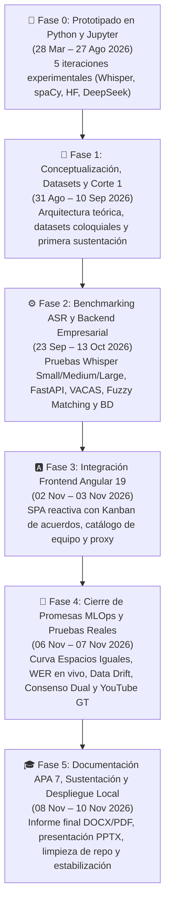

# ⏳ Línea de Tiempo Maestra del Proyecto: Transcriptor Maestro

> **Trazabilidad Histórica Completa (Marzo 2026 – Noviembre 2026)**  
> Reconstrucción cronológica exhaustiva basada en los metadatos del sistema de archivos (`CreationTime` / `LastWriteTime`) y el registro inmutable de commits en Git (`origin/main`), desde los primeros experimentos en Jupyter Notebooks y scripts de Python hasta la plataforma empresarial Full-Stack MLOps funcionando en entorno local.

---

## 🗺️ Visión General de la Evolución (6 Fases)

---

## 🧪 FASE 0: Génesis y Prototipado Experimental en Python
**Periodo:** 28 de marzo de 2026 – 27 de agosto de 2026  
**Objetivo:** Explorar distintas aproximaciones tecnológicas para transcribir voz a texto (ASR) y extraer compromisos estructurados sin depender de toma de notas manual.

### 📍 28 de marzo de 2026 — Primeros experimentos en Jupyter Notebooks (`jupiter/`)
- **`14:07:18` | `jupiter/intento 4 FUNCIONA`:** Desarrollo de *Prompt Engineering* especializado sobre la API de DeepSeek para detectar acuerdos implícitos en conversaciones informales (ej. *"yo me encargo"*) y exportar un Cuadro de Mando en Markdown.
- **`15:11:14` | `jupiter/intento 3 FUNCIONA`:** Primer flujo base funcional combinando `openai-whisper` local (modelo `small`) con `deepseek-chat` para obtener salidas en `.txt` y `.json`.
- **`15:53:18` | `jupiter/intento 1 FUNCIONA DIARIZACION`:** Prototipo 100% *offline* sin LLMs. Utilizó `openai-whisper` para ASR, `torchaudio` para diarización por energía acústica, y procesamiento lingüístico clásico con `spaCy` + expresiones regulares (Regex) para detectar verbos de acción.

### 📍 03 de mayo de 2026 — Optimización de memoria (*Chunking*) y Resumen Ejecutivo
- **`12:39:10` | `jupiter/intento 2 FUNCION SIN DEEPSEEK`:** Incorporación del *pipeline* de `transformers` (Hugging Face) con **fragmentación (*Chunking*) de 30 segundos** para evitar desbordamientos de RAM/VRAM (*Out-Of-Memory*), conectándose a la Inference API (`moonshotai/Kimi-K2-Instruct-0905`).
- **`12:52:32` | `jupiter/intento 5 FUNCIONA WHISPER DEEPSEEK`:** Prototipo híbrido maduro. Unió el *Chunking* de 30s de Hugging Face con una **doble llamada a DeepSeek**: la primera para extraer el JSON de tareas y la segunda para redactar un **Resumen Ejecutivo** de la reunión.

### 📍 04 al 27 de agosto de 2026 — Recopilación de grabaciones reales y consolidación en scripts (`.py`)
- **`04 Ago – 27 Ago` | Carpeta `clases/`:** Inicio del registro de sesiones académicas reales (`01.03ago DevOps`, `02.06ago Electiva 2`, `03.10ago`, `04.20ago`, `05.24ago`), que posteriormente servirían como corpus de estrés.
- **`27 Ago 2026 (16:29 – 16:30)` | Carpeta `pys/`:** Empaquetado de los 5 notebooks en scripts puros de Python:
  1. `intento_1_funciona_diarizacion.py`
  2. `intento_2_funcion_sin_deepseek (1).py`
  3. `intento_3_funciona.py`
  4. `intento_4_funciona.py`
  5. `intento_5_funciona_whisper_deepseek.py`
- **`27 Ago 2026 (16:41 – 17:08)` | Documentación fundacional en raíz:**
  - `16:41` — Creación de `contexto.md` definiendo las 3 etapas del sistema (Transcripción, Extracción y Exportación).
  - `16:43` — Creación de `SISTEMA INTELIGENTE DE SEGUIMIENTO DE ACUERDOS Y CONTROL DE PROYECTOS (6).md`.
  - `16:45` — Creación de `tarea.md` y `solucion-contenido-completo.md`.
  - `16:56` — Creación de `arquitectura.md` con los primeros lineamientos de diseño.
  - `17:02` — Creación de `versiones_prototipos.md` con la matriz multicriterio comparando los 5 prototipos (precisión, consumo de RAM, privacidad, latencia y mantenibilidad).

---

## 📐 FASE 1: Diseño Arquitectónico, Datasets y Entrega de Corte 1
**Periodo:** 31 de agosto de 2026 – 10 de septiembre de 2026  
**Objetivo:** Formalizar el caso de negocio, construir conjuntos de datos de validación con lenguaje coloquial latinoamericano y sustentar el primer corte académico.

### 📍 31 de agosto de 2026 — Observaciones y creación de Datasets
- **`18:55 – 19:10` | Carpeta `observaciones/`:** Registro y análisis de retroalimentación técnica (`obs1.md`, `obs-crudo.txt`, `analisis/analisis1.md` y `analisis2.md`).
- **`19:07 – 20:13` | `dataset.md` y `dataset-informal.md`:** Construcción de transcripciones de prueba con modismos, interrupciones, apodos (*"Juancho"*, *"Carlitos"*, *"Mary"*) y compromisos ambiguos para evaluar la robustez de los prompts.

### 📍 01 al 03 de septiembre de 2026 — Entregables de Corte 1 (`presentacion/`)
- **`01 Sep (17:04)`:** Estructuración de diapositivas en `estructura-presentacion.md` y cierre de `solucion-contenido-completo.md`.
- **`03 Sep (09:47 – 19:05)`:** Creación de la carpeta `presentacion/` con:
  - `Documento-Solucion-Seguimiento-Acuerdos.docx.md` (informe de formulación).
  - `presentacion.md` y `guion.md` (discurso de sustentación donde se plantearon las promesas arquitectónicas: tolerancia a fallos *VACAS*, *Fuzzy Matching* y *Curva de Espacios Iguales*).

### 📍 10 de septiembre de 2026 — Consolidación de modelos en Colab (`otras-actividades/`)
- **`14:38 – 15:12`:** Desarrollo de scripts complementarios (`codigo1.py`, `codigo2.py`, `modelo_final_colab.py`), evaluación contra rúbrica (`rubrica.md`, `avance1.md` a `avance4.md`) y generación de `documento_final_expandido.md`.

---

## ⚙️ FASE 2: Benchmarking de Whisper y Construcción del Backend Empresarial
**Periodo:** 23 de septiembre de 2026 – 13 de octubre de 2026  
**Objetivo:** Evaluar cuantitativamente las variantes de Whisper (`Small`, `Medium`, `Large`) y transformar los scripts aislados en una plataforma backend multicapa con FastAPI, PostgreSQL y alta disponibilidad.

### 📍 23 al 28 de septiembre de 2026 — Pruebas de estrés ASR (`metricas/audios-trasncritos/`)
- **`23 Sep (20:34)`:** Preparación del audio patrón `original.mp3`.
- **`28 Sep (08:58 – 10:08)`:** Ejecución de baterías de transcripción comparativa:
  - `08:58 – 09:09`: Transcripciones con **Whisper Small** (`Small-(1).mp3.txt`, `Small-(2).mp3.txt`, `Small-(3).mp3.txt`).
  - `09:03 – 09:11`: Transcripciones con **Whisper Medium** (`medium-(1).mp3.txt`, `medium-(2).mp3.txt`, `medium-(3).mp3.txt`).
  - `09:24 – 10:08`: Transcripciones con **Whisper Large** (`large-(1).mp3.txt`, `large-(2).mp3.txt`, `large-(3).mp3.txt`).

### 📍 06 de octubre de 2026 — Informe de Métricas y Nacimiento del Backend (`prototipos/backend/`)
- **`15:53 – 16:03` | Carpeta `metricas/`:** Redacción de `INFORME CORPORATIVO.md`, `metricas.md`, `metricas-al-caso.md`, `original.txt` y `rendimiento-modelos.txt`.
- **`16:04 – 19:00` | Creación de `prototipos/backend/`:** Diseño e implementación de la API REST empresarial:
  - **Framework:** FastAPI + Uvicorn con patrón de respuesta estandarizado `ResponseDto<T>` (`app/schemas/response.py`).
  - **Capa de Datos (`app/db/`):** Modelos SQLAlchemy para `Proyecto`, `Reunion`, `Acuerdo`, `Responsable`, `Historial` y `Auditoria`, con *fallback* automático de PostgreSQL a SQLite.
  - **Resiliencia IA (`app/services/vacas.py` & `app/core/perceptron.py`):** Implementación del orquestador **VACAS** (*Hot Failover* entre DeepSeek, Hugging Face / Kimi-K2 y motor de reglas *offline*) y clasificador de salud **El Perceptrón**.
  - **Resolución de Identidades (`app/services/matching.py`):** Algoritmo de *Fuzzy Matching* basado en distancia de Levenshtein (`rapidfuzz`) para vincular apodos hablados con el catálogo oficial de responsables.
  - **Suite de Pruebas (`backend/tests/`):** Creación de `test_api.py`, `test_phase2.py`, `test_phase3.py`, `test_phase4.py` y `run_tests.py`.
  - **Contrato de Interfaz (`19:00`):** Creación de `backend/FRONTEND_HANDOFF.md` especificando todos los endpoints y payloads JSON para el equipo de Frontend.

### 📍 08 de octubre de 2026 — Inicialización del Repositorio Git y Subida del Backend
- **`17:27:30` | Commit `901a362` (`first commit`):** Inicialización del repositorio Git en `prototipos/` con `README.md`.
- **`17:51:44` | Commit `0f502b6` (`second commit`):** Subida oficial del núcleo del Backend (**46 archivos, +3,287 líneas de código**), incluyendo controladores REST (`reuniones`, `acuerdos`, `responsables`, `auditoria`), servicios de IA y suite de tests.
- **`18:29:04`:** Creación de `backend/doc.md` detallando la arquitectura por capas.

### 📍 13 de octubre de 2026 — Base de Datos PostgreSQL y Gestión de Almacenamiento
- **`15:54 – 15:57` | Carpeta `prototipos/db/`:** Creación del script DDL `db/db.sql` (con extensión `uuid-ossp`, llaves foráneas, índices y catálogo semilla), `db/README.md` y `backend/GUIA_INICIO_BACKEND.md`.
- **`16:02:23` | Commit `ddabe73` (`tercer commit`):** Incorporación del módulo `db/`, guías de despliegue para principiantes y mejoras en los servicios `ai_handler.py` y `vacas.py` (**12 archivos, +650 líneas**).
- **`17:43:50` | Commit `191e3ba` (`cuarto commit`):** Creación del servicio de administración de archivos temporales (`storage_service.py`), el endpoint `/api/v1/sistema` y el script `scripts/clean_storage.py` (**9 archivos, +441 líneas**).

---

## 🅰️ FASE 3: Desarrollo e Integración del Frontend en Angular 19
**Periodo:** 02 de noviembre de 2026 – 03 de noviembre de 2026  
**Objetivo:** Construir una interfaz gráfica moderna (SPA) conectada a los contratos `ResponseDto<T>` del backend.

### 📍 02 de noviembre de 2026 — Construcción de `frontend-angular/`
- **`15:07:01` | Commit `1885862` (`front` — autor: `BABR` / Bryan Betancourt):** Incorporación del proyecto **Angular 19** basado en componentes *standalone* y *signals* (**30 archivos, +17,753 líneas**):
  - **Vistas principales (`src/app/pages/`):**
    - `subir.component.ts`: Carga *drag & drop* de audios/textos, selector de estrategia IA y *polling* de estado cada 2.5 segundos.
    - `minuta.component.ts`: Visualización de resumen ejecutivo, transcripción y acuerdos con cita textual.
    - `historial.component.ts`: Listado cronológico de reuniones procesadas.
    - `acuerdos.component.ts`: Tablero **Kanban interactivo** (*Drag & Drop*) entre estados (`pendiente`, `en_progreso`, `completado`, `atrasado`).
    - `equipo.component.ts`: Directorio de integrantes y alta de alias para *Fuzzy Matching*.
    - `auditoria.component.ts`: Panel de telemetría de IA, simulación de fallos (*Chaos Engineering*) y limpieza de caché.
  - **Componentes compartidos (`src/app/shared/`):** `tabla-acuerdos.component.ts` y `fuzzy-badge.component.ts`.
  - **Proxy (`proxy.conf.json`):** Redirección transparente de `/api` y `/health` hacia `http://127.0.0.1:8000`.
- **`15:16:11` | Commit `22fe3a8` (`corrregir` — autor: `BABR`):** Ajuste en el controlador `backend/app/api/v1/endpoints/responsables.py`.

### 📍 03 de noviembre de 2026 — Pruebas de Compilación Local
- **`09:20 – 09:24`:** Generación del bundle de producción en `frontend-angular/dist/` y validación de rutas en local.

---

## 🔬 FASE 4: Cierre Integral de Promesas MLOps y Validación con Ground Truth
**Periodo:** 06 de noviembre de 2026 – 07 de noviembre de 2026  
**Objetivo:** Cumplir al 100% todas las promesas técnicas formuladas en el Corte 1 y Corte 2, elevando el prototipo a una plataforma MLOps auditable en tiempo real.

### 📍 06 de noviembre de 2026 (Mañana) — Auditoría de Promesas y Despliegue MLOps
- **`09:30:10` | Commit `e7e7a62`:** Configuración de entorno de desarrollo en Angular (`environment.development.ts`).
- **`09:45 – 12:03` | Carpeta `EntregaFinal/`:** Creación de los documentos de auditoría y diseño de cierre:
  - `CONSOLIDADO_MAESTRO_ENTREGA_FINAL.md` (`09:50`)
  - `instrucciones-finales.md` (`09:56`)
  - `promesas.md` (`10:03`)
  - `evaluacion-promesas-parte1.md` (`10:41`)
  - `plan-implementacion-cierre.md` (`12:03`)
- **`13:58:37` | Commit `2728534` (`feat: implementacion integral del plan de cierre de promesas`):** Hito mayor de ingeniería (**28 archivos modificados, +2,554 líneas de código**):
  1. **Curva de Espacios Iguales (`scheduler.py` & `alert_service.py`):** Algoritmo matemático que calcula intervalos progresivos de recordatorio ($50\%$, $75\%$, $90\%$ del tiempo restante y vencimiento) ejecutado en segundo plano con `APScheduler`.
  2. **Sistema de Alertas Persistentes (`models/alerta.py` & campana en UI):** Notificaciones clasificadas por severidad (`INFO`, `WARNING`, `CRITICAL`) con soporte de despacho vía Webhook y panel interactivo en la barra superior de Angular.
  3. **Calibrador de WER y WER Ponderado en Vivo (`eval_service.py`):** Cálculo dinámico de tasa de error de palabras mediante programación dinámica (Levenshtein), penalizando con doble peso ($2.0\times$) errores en verbos de compromiso, fechas y nombres de responsables.
  4. **Detector de Data Drift Léxico (`eval_service.py`):** Monitoreo de tasa *Out-Of-Vocabulary (OOV)* y densidad de jerga coloquial para emitir alertas de reentrenamiento o ajuste de prompts.
  5. **Prompt & Model Registry (`prompt_registry.py`):** Gestión versionada de plantillas de prompts con firma de integridad MD5 (`v1.0-base`, `v2.0-informal`, `v3.0-ejecutivo`).
  6. **Modo Consenso Dual en VACAS (`vacas.py`):** Ejecución concurrente en paralelo (`ThreadPoolExecutor`) entre el proveedor primario y la réplica bajo un SLA estricto ($< 3\text{ s}$), fusionando acuerdos y marcando discrepancias.
  7. **Suite de Verificación End-to-End:** Creación de `backend/test_pipeline_completo.py`.

### 📍 06 de noviembre de 2026 (Tarde y Noche) — Estabilización con Audios Reales
- **`13:54` | Carpeta `clases/`:** Consolidación de las 14 transcripciones de clases del semestre (`01.03ago` hasta `14.05novElectiva.m4a.txt`).
- **`19:46` | Carpeta `audio/`:** Incorporación del audio real de prueba `Segmento 1, comunicacion en la organizacion y liderazgo.mp3`.
- **`20:49:56` | Commit `d1fdb6c` (`fix(vacas)`):** Ampliación del timeout HTTP a 25s, prompt híbrido tolerante a monólogos académicos y parser JSON resiliente frente a bloques Markdown.
- **`21:29:55` | Commit `88e6211` (`chore(deps)`):** Inclusión de `imageio-ffmpeg` en `requirements.txt` para garantizar decodificación universal de códecs de audio en Whisper sin requerir instalación manual en el sistema operativo.
- **`22:03:04` | Commit `d22cdba` (`docs`):** Creación de `ANALISIS_COMPARATIVO_WHISPER_SMALL_VS_MEDIUM.md`.

### 📍 07 de noviembre de 2026 — Benchmark Tripartito con Ground Truth
- **`08:26:29` | Commit `fa8c1ca` (`docs: actualizar analisis comparativo tripartito`):** Incorporación de **Whisper Large** y el **Ground Truth de YouTube**, demostrando con evidencia empírica el fenómeno de alucinación/truncamiento en modelos pesados sin calibración de *chunking* y validando a **Whisper Medium** como el punto de equilibrio óptimo (*Sweet Spot*: $100\%$ de cobertura léxica y $90\%$ de precisión en compromisos).
- **`08:41:55` | Commit `d1391de`:** Respaldo inicial de los documentos de `EntregaFinal/` en el repositorio.

---

## 🎓 FASE 5: Documentación Académica APA 7, Sustentación y Operación Local
**Periodo:** 08 de noviembre de 2026 – 10 de noviembre de 2026  
**Objetivo:** Construir el informe técnico final bajo normas APA 7, el guion y presentación de sustentación final, depurar el repositorio de producción y dejar la plataforma corriendo localmente sin errores.

### 📍 08 de noviembre de 2026 — Articulación Narrativa (Corte 1 ➔ Corte 2 ➔ Final)
- **`13:16:20` | Commit `59dd8d5`:** Diseño de la arquitectura de diapositivas y Prompt Maestro en `PRESENTACION_FINAL_PROYECTO.md`.
- **`13:23 – 13:24` | Carpeta `presentacion/corte 2/`:** Archivo de respaldo de la presentación y guion del Corte 2 (`Guion_Whisper.docx`, `Presentacion_Electiva_Whisper.pptx`).
- **`13:32:00` | Commit `1c3271c`:** Articulación del guion narrativo conectando los tres cortes del semestre.

### 📍 09 de noviembre de 2026 — Maquetación APA 7, Exportación DOCX/PDF y Depuración en Vivo
- **`11:57:26` | Commit `71963b5`:** Creación de `GUION_SUSTENTACION_FINAL.md` con discurso literal por diapositiva y banco de respuestas para preguntas del jurado.
- **`12:32 – 13:06` | Automatización Documental en `EntregaFinal/doxc/`:**
  - Desarrollo de scripts de generación gráfica y formato: `generar_figuras.py` (diagramas en PNG de alta resolución), `actualizar_markdown_apa.py` y `apply_table_borders.py` (bordes negros sólidos APA/IEEE, encabezados `#EAEAEA`, control de paginación `cantSplit` y `tblHeader`).
  - Generación de las 4 figuras técnicas: `figura1_chunking.png`, `figura2_arquitectura.png`, `figura3_secuencia_curva.png` y `figura4_chaos_engineering.png`.
  - Commits `e6f8fd0`, `ab357a9` y `409d469`: Exportación final de `DOCUMENTO_FINAL_PROYECTO.docx` y `.pdf` sin emojis, con 47 títulos/subtítulos en negrilla y citación APA 7 en todas las tablas y figuras.
- **`13:14:57` | Commit `db593aa` (`chore: limpiar repositorio`):** Depuración estricta del repositorio Git (`prototipos/`), dejando únicamente `README.md` en la raíz y los dos entregables ejecutivos (`DOCUMENTO_FINAL_PROYECTO.docx.pdf` y `Transcriptor Maestro – Sustentación Final (1).pptx`) en `prototipos/EntregaFinal/`, preservando todos los archivos `.md` de investigación localmente fuera del repo.
- **`13:20:44` | Commit `677ce48` (`docs: completar y actualizar README maestro`):** Documentación integral de prerrequisitos, creación de entornos virtuales (`venv`), variables `.env`, inicialización de PostgreSQL/SQLite y levantamiento de servicios.
- **`15:30:08` | Commit `0fc841c` (`fix(schemas)`):** Durante la prueba funcional en vivo del sistema completo (Backend puerto `8000` + Frontend puerto `4200`), se detectó y corrigió la validación de campos `creado_en` nulos en `ResponsableResponse` y `CalibrarWERResponse`, dejando la pestaña **Equipo** y todos los módulos operando al 100%.

### 📍 10 de noviembre de 2026 — Consolidación Histórica y Control de Cancelación en Vivo
- **`10:03` | `EntregaFinal/linea-de-tiempo.md`:** Documentación de la cronología completa del proyecto desde los prototipos iniciales hasta el sistema en producción local.
- **`15:31:27` | Commit `f3d5512` (`feat(reuniones): agregar boton y endpoint de cancelacion de procesamiento en curso`):** Incorporación del estado `CANCELADO`, endpoint `POST /api/v1/reuniones/{id_reunion}/cancelar`, puntos de interrupción segura en `AIHandler` / `ReunionService`, limpieza automática de temporales y botón **⏹ Detener procesamiento** en las vistas de **Subir reunión**, **Historial** y **Minuta**.

---

## 📊 Registro Histórico de Commits en el Repositorio (`origin/main`)

| # | Fecha y Hora | Commit Hash | Autor | Descripción del Hito | Impacto |
| :-: | :--- | :---: | :--- | :--- | :--- |
| **1** | `2026-10-08 17:27:30` | `901a362` | FelipeCastro | `first commit` — Inicialización del repositorio Git. | 1 archivo (+1) |
| **2** | `2026-10-08 17:51:44` | `0f502b6` | FelipeCastro | `second commit` — Subida del Backend FastAPI, VACAS, Perceptrón, Fuzzy Matching y tests. | 46 archivos (+3,287) |
| **3** | `2026-10-13 16:02:23` | `ddabe73` | FelipeCastro | `tercer commit` — Esquema PostgreSQL (`db.sql`), guía de inicio y mejoras en servicios IA. | 12 archivos (+650) |
| **4** | `2026-10-13 17:43:50` | `191e3ba` | FelipeCastro | `cuarto commit` — Servicio de almacenamiento (`storage_service.py`), limpieza y endpoints de sistema. | 9 archivos (+441) |
| **5** | `2026-11-02 15:07:01` | `1885862` | BABR | `front` — Integración de la SPA en Angular 19 con todas las vistas y proxy inverso. | 30 archivos (+17,753) |
| **6** | `2026-11-02 15:16:11` | `22fe3a8` | BABR | `corrregir` — Ajuste en controlador de responsables. | 1 archivo (+5) |
| **7** | `2026-11-06 09:30:10` | `e7e7a62` | FelipeCastro | `chore(frontend)` — Configuración de `environment.development.ts`. | 1 archivo (+7) |
| **8** | `2026-11-06 13:58:37` | `2728534` | FelipeCastro | `feat` — Implementación integral MLOps: Curva Espacios Iguales, Alertas, WER, Data Drift, Prompt Registry y Consenso VACAS. | 28 archivos (+2,554) |
| **9** | `2026-11-06 20:49:56` | `d1fdb6c` | FelipeCastro | `fix(vacas)` — Ampliación de timeout HTTP a 25s y robustecimiento de prompt híbrido y parser JSON. | 3 archivos (+54) |
| **10** | `2026-11-06 21:29:55` | `88e6211` | FelipeCastro | `chore(deps)` — Adición de `imageio-ffmpeg` para soporte universal de códecs de audio en Whisper. | 2 archivos (+3) |
| **11** | `2026-11-06 22:03:04` | `d22cdba` | FelipeCastro | `docs` — Análisis comparativo experimental entre Whisper Small y Medium. | 1 archivo (+127) |
| **12** | `2026-11-07 08:26:29` | `fa8c1ca` | FelipeCastro | `docs` — Análisis comparativo tripartito incorporando Whisper Large y Ground Truth de YouTube. | 1 archivo (+104) |
| **13** | `2026-11-07 08:41:55` | `d1391de` | FelipeCastro | `docs` — Respaldo inicial de la carpeta `EntregaFinal` en el repositorio. | 8 archivos (+1,885) |
| **14** | `2026-11-08 13:16:20` | `59dd8d5` | FelipeCastro | `docs` — Adición de Prompt Maestro para generación de diapositivas en `PRESENTACION_FINAL_PROYECTO.md`. | 1 archivo (+109) |
| **15** | `2026-11-08 13:32:00` | `1c3271c` | FelipeCastro | `docs` — Articulación del guion narrativo conectando Corte 1, Corte 2 y Entrega Final. | 1 archivo (+26) |
| **16** | `2026-11-09 11:57:26` | `71963b5` | FelipeCastro | `docs` — Creación de `GUION_SUSTENTACION_FINAL.md` con discurso continuo y banco de preguntas. | 1 archivo (+107) |
| **17** | `2026-11-09 12:42:21` | `e6f8fd0` | FelipeCastro | `docs` — Actualización de `DOCUMENTO_FINAL_PROYECTO.md` con figuras PNG APA, tablas estilizadas y exportación `.docx`. | 10 archivos |
| **18** | `2026-11-09 12:55:00` | `ab357a9` | FelipeCastro | `style` — Formato de todos los títulos y subtítulos en negrilla en `.md` y `.docx`. | 4 archivos |
| **19** | `2026-11-09 13:06:59` | `409d469` | FelipeCastro | `docs` — Conversión del bloque de log de Chaos Engineering en Figura 4 bajo formato APA. | 4 archivos |
| **20** | `2026-11-09 13:14:57` | `db593aa` | FelipeCastro | `chore` — Limpieza del repositorio dejando únicamente `README.md` en raíz y `.pdf`/`.pptx` en `EntregaFinal`. | Limpieza repo |
| **21** | `2026-11-09 13:20:44` | `677ce48` | FelipeCastro | `docs` — Actualización completa del `README.md` maestro con guía de instalación, `venv` y `.env`. | 1 archivo (+201) |
| **22** | `2026-11-09 15:30:08` | `0fc841c` | FelipeCastro | `fix(schemas)` — Soporte para `creado_en` nulo en `ResponsableResponse` y `CalibrarWERResponse`. | 2 archivos (+2) |
| **23** | `2026-11-10 15:31:27` | `f3d5512` | FelipeCastro | `feat(reuniones)` — Botón y endpoint `POST /reuniones/{id}/cancelar` para detener procesamientos en curso. | 12 archivos (+229) |

