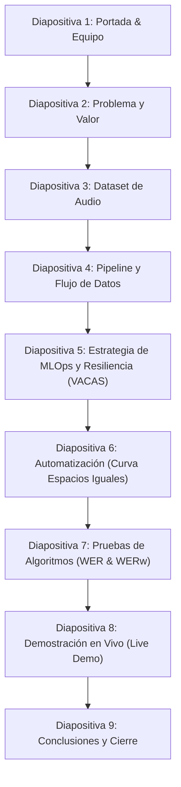

# 📋 Guía y Estructura Maestra de Entregables: Proyecto Final

> **Asignatura:** Electiva II - Sistemas Inteligentes / MLOps  
> **Proyecto:** Transcriptor Maestro — Sistema Inteligente de Seguimiento de Acuerdos y Control de Proyectos  
> **Corte:** Tercer Corte (Entrega Final y Sustentación)  
> **Fuente de Directrices:** Transcripción Clase 14 (05 de Noviembre) y Rúbrica Oficial de Evaluación

---

## 📦 1. Lista General de Entregables (Plataforma y Repositorio)

Para la entrega formal del proyecto se deben compilar y subir los siguientes **5 artefactos principales**:

| # | Entregable | Formato / Medio | Propósito Principal |
| :-: | :--- | :--- | :--- |
| **1** | **Repositorio GitHub** | URL Pública | Repositorio con el código fuente completo, estructura limpia de carpetas y control de versiones formal. |
| **2** | **README del Repositorio** | `README.md` (Markdown) | Portada técnica: qué es el sistema, arquitectura, requisitos, guía de despliegue en local y resolución de problemas. |
| **3** | **Documento del Proyecto** | PDF / Word estructurado | Memoria técnica completa y rigurosa del sistema, abarcando desde la concepción del problema hasta las métricas finales. |
| **4** | **Presentación del Proyecto** | Diapositivas (PDF / PPT) | Apoyo visual para la sustentación oral frente al profesor y al curso (máx. 10 a 12 diapositivas). |
| **5** | **Demostración en Vivo (*Live Demo*)** | Aplicación Funcionando | Prueba funcional de extremo a extremo: ingestión de audio, transcripción, extracción de acuerdos, alertas y panel MLOps. |

---

## 📑 2. Estructura Requerida para el Documento Final

El documento escrito es la memoria técnica formal de la asignatura y debe estructurarse obligatoriamente bajo los siguientes capítulos:

### Capítulo 1: Contexto y Formulación del Problema
* **1.1. Antecedentes y Problemática:** Pérdida de acuerdos, compromisos verbales no registrados y seguimiento ineficiente en reuniones corporativas.
* **1.2. Justificación:** Relevancia de un asistente inteligente de escucha, extracción y auditoría para la productividad de equipos de ingeniería.
* **1.3. Objetivos:** Objetivo general del sistema y objetivos específicos de investigación/desarrollo.

### Capítulo 2: El Dataset (Conjunto de Datos)
> [!IMPORTANT]
> El profesor aclaró enfáticamente en clase que el entregable de datos es el **Dataset de audios y transcripciones**, NO el modelo de tablas de una base de datos relacional.

* **2.1. Naturaleza y Colección de Muestras:** Audios de reuniones simuladas y reales del equipo de trabajo (grabaciones con ruido ambiente representativo y lenguaje conversacional).
* **2.2. Metadatos Técnicos:** Formatos (`.mp3`, `.wav`, `.m4a`), tasa de muestreo (16kHz), canales (mono/estéreo) y distribución de duración (en minutos/segundos).
* **2.3. Preprocesamiento de Señal:** Segmentación, normalización de audio y división por chunks (30s con solapamiento).

### Capítulo 3: Arquitectura, Flujo de Datos y MLOps / DevOps
* **3.1. Flujo de Datos (*Pipeline End-to-End*):** Diagrama de arquitectura que conecte:
  $$\text{Audio} \longrightarrow \text{Chunking} \longrightarrow \text{ASR Whisper} \longrightarrow \text{LLM Extractor} \longrightarrow \text{Fuzzy Matcher} \longrightarrow \text{Perceptrón} \longrightarrow \text{Frontend UI}$$
* **3.2. Ciclo de Vida MLOps:**
  * **Monitoreo de Data Drift:** Detección de desviación léxica mediante análisis *Out-Of-Vocabulary* (OOV) y alerta por modismos coloquiales.
  * **Prompt & Model Registry:** Control de versiones de plantillas de prompts (`v1_base`, `v2_informal`, `v3_hibrido`) con trazabilidad de hashes MD5 inmutables.
* **3.3. Alta Disponibilidad y Resiliencia (*VACAS* & *El Perceptrón*):**
  * Mecanismo *Hot-Failover* (DeepSeek $\rightarrow$ OpenAI $\rightarrow$ Reglas Offline).
  * Modo Consenso Concurrente dual con umbral de tolerancia a discrepancia ($\le 20\%$).
  * Clasificación de latencias bajo SLA de 3 segundos y niveles de error 0 a 4 con El Perceptrón.
* **3.4. DevOps & Automatización:**
  * Curva de Espacios Iguales mediante scheduler periódico nocturno (`APScheduler`).
  * Emisión y despacho multicanal de alertas por tareas vencidas u omitidas.

### Capítulo 4: Pruebas y Evaluación de Algoritmos
> [!NOTE]
> *"El nivel de las pruebas a sus algoritmos"* (Énfasis de la Clase 14). No basta con mostrar que funciona; debe demostrarse matemáticamente la calidad de los modelos.

* **4.1. Evaluación de ASR (Whisper):**
  * Definición y cálculo del **WER** clásico:
    $$\text{WER} = \frac{S + D + I}{N}$$
  * Definición del **WER Ponderado ($\text{WER}_w$)**: penalización estricta sobre fechas/números/negaciones ($3.0$), nombres propios ($2.0$) y verbos clave ($1.5$).
  * Precisión a nivel de palabra ($\frac{H}{N}$), Longitud Relativa ($\frac{N_{hyp}}{N_{ref}}$) y tasas de sustitución, eliminación e inserción.
* **4.2. Benchmarking de Enfoques:** Comparativa entre los prototipos desarrollados (Estrategia 1 Offline hasta Estrategia 5 Híbrido Maduro).
* **4.3. Pruebas de Resiliencia (*Chaos Engineering*):** Pruebas de simulación de caída forzada del LLM primario y tiempo de conmutación ($< 1.5\text{s}$).

### Capítulo 5: Resultados, Conclusiones y Trabajo Futuro
* **5.1. Cumplimiento de Metas:** Evidencia de cumplimiento frente a las promesas iniciales del proyecto.
* **5.2. Conclusiones Técnicas:** Lecciones aprendidas en el manejo de modelos de audio, LLMs como cajas negras y resolución de identidades.
* **5.3. Referencias Bibliográficas:** Fuentes académicas de modelos (Whisper, Levenshtein, transformers).

---

## 📽️ 3. Estructura de la Presentación (Diapositivas para Sustentación)

El docente especificó un orden fluido y sintético para la presentación oral:

1. **Diapositiva 1 — Portada:** Nombre del proyecto (*Transcriptor Maestro*), integrantes y asignatura.
2. **Diapositiva 2 — El Problema:** Pérdida de acuerdos en reuniones corporativas y costo operativo de la informalidad verbal.
3. **Diapositiva 3 — El Dataset:** Colección de grabaciones, duración, metadatos, ambiente acústico y preprocesamiento.
4. **Diapositiva 4 — Arquitectura y Flujo de Datos:** Diagrama del pipeline completo desde la ingestión hasta la asignación de responsables.
5. **Diapositiva 5 — MLOps y Resiliencia (*VACAS* + *Perceptrón*):**
   * Cadena de contingencia en caliente.
   * Modo Consenso Concurrente ($\Delta \le 20\%$).
   * Prompt Registry y monitoreo de Data Drift léxico.
6. **Diapositiva 6 — Automatización y Alertas:** Curva de Espacios Iguales, barrido de atrasos y omisiones.
7. **Diapositiva 7 — Evaluación y Pruebas a Algoritmos:** Métricas matemáticas de $WER$, $WER_w$, comparación de prototipos y tabla de resultados.
8. **Diapositiva 8 — Demostración en Vivo (*Live Demo*):** Subida de archivo, extracción en tiempo real, disparo del barrido de alertas y tablero MLOps.
9. **Diapositiva 9 — Conclusiones:** Logros alcanzados, contrastación de promesas y cumplimiento del 100%.

---

## 🎤 4. Directrices Críticas para la Sustentación

Basado en las advertencias de la Clase 6 y la Clase 14:

1. **Dominio Individual y Transversal:**
   * Todos los integrantes del grupo deben estar en capacidad de responder por **cualquier parte del código o de la arquitectura**.
   * El profesor formulará preguntas aleatorias a integrantes específicos (e.g., *"¿cómo funciona la función de pérdida acá?", "¿por qué este peso vale 3.0 en el WER?", "¿qué ocurre si se desconecta la API primaria?"*).
2. **Defensa Teórica y Matemática (No solo mostrar interfaces):**
   * Explicar el fundamento técnico: algoritmo de Levenshtein, programación dinámica, descenso del gradiente, funciones de costo y tratamiento de cajas negras en LLMs.
3. **Cero Dependencia de Redes Externas Críticas:**
   * El sistema debe contar con modo de respaldo local offline para garantizar que la sustentación no se caiga por problemas de internet o cuotas de API.

---

## 🛠️ 5. Guión del *Live Demo* durante la Sustentación

1. **Ingestión de Reunión (`/subir`):**
   * Subir un audio o transcripción de prueba.
   * Mostrar el switch de **Modo Consenso Dual** (DeepSeek + OpenAI en paralelo).
2. **Resultados de la Minuta (`/minuta`):**
   * Mostrar la transcripción generada, resumen ejecutivo y la tabla de compromisos asignados por *Fuzzy Matching*.
3. **Curva de Espacios Iguales y Alertas (Campana `🔔`):**
   * Abrir el panel de notificaciones en el header.
   * Hacer clic en **"⚡ Ejecutar Curva Espacios Iguales"** en vivo y mostrar cómo el scheduler detecta compromisos atrasados y omisiones históricas.
4. **Tablero MLOps (`/auditoria`):**
   * Mostrar la calibración de **WER** con el visualizador de diff palabra por palabra resaltado en colores.
   * Mostrar el analizador de **Data Drift** detectando modismos informales (*"camello"*, *"hacer la vuelta"*).
   * Mostrar el **Prompt Registry** y activar una versión de prompt en caliente con un clic.
